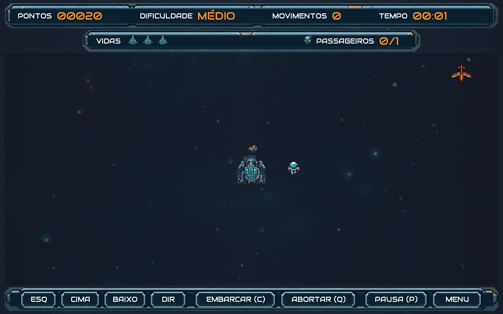
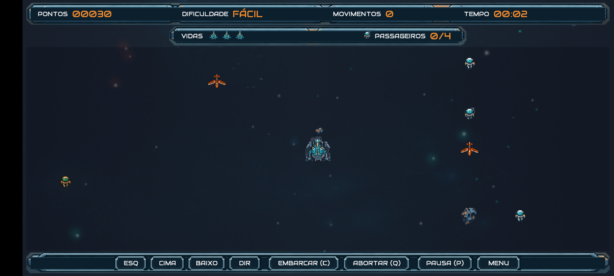

# 🚀 Missão Marte

Jogo em Java desenvolvido na disciplina de **Projeto e Arquitetura de Sistemas
(UNIFOR)**. Começou como um jogo de console e foi evoluindo, fase a fase, até
virar um jogo gráfico com LibGDX, servidor de ranking com Spring Boot e versão
Android, sempre preservando as regras do jogo e aplicando princípios SOLID e
padrões de projeto.

**Repositório:** [jpedro-lc/Projeto_Arquitetura-Missao_Marte](https://github.com/jpedro-lc/Projeto_Arquitetura-Missao_Marte)
· **Acompanhamento:** [GitHub Project "Missão Marte — Evolução Arquitetural"](https://github.com/users/jpedro-lc/projects/16)

| Desktop (LibGDX) | Android (celular real) |
|---|---|
|  |  |

---

## 👥 Equipe

| Integrante | Matrícula / Usuário Git | Contribuições nas missões 1 e 2 |
| :--- | :--- | :--- |
| **José Lucas Queiroz Bastos** | 2517303 <br> Git: `XLILzezim` | Questões 1, 4, 7 e elaboração do arquivo PDF |
| **João Pedro Lima Carvalho** | 2510511 <br> Git: `jpedro-lc` | Questões 2, 5, 8 e 10 |
| **Gleison Gomes Fraga Filho** | 2517333 <br> Git: `gleisongomes-creator` | Questões 3, 6 e 9 |

---

## 🌌 O jogo

A humanidade olha para as estrelas, e o próximo grande passo é o planeta
vermelho. O jogador comanda uma nave que precisa resgatar a tripulação
essencial (astronautas, o **Professor** e o **Engenheiro**) perdida pelo espaço,
desviando de **asteroides** e **inimigos**, e voltar à base antes que acabem
as vidas ou os pontos.

- **Navegação em grade 2D**, um movimento por turno; os inimigos se movem a cada turno.
- **Pontuação:** a partida começa com 30, 20 ou 15 pontos (Fácil, Médio,
  Difícil); cada movimento custa 1 ponto e cada passageiro embarcado soma a sua
  pontuação. Chegar a zero é derrota.
- **Vidas:** a nave tem 3; colidir com asteroide ou inimigo custa uma.
- **Vitória:** embarcar todos os passageiros e retornar à base.
- **Ranking:** local para convidados e global (servidor) para jogadores com conta.

---

## 🧭 Evolução arquitetural

O trabalho foi conduzido em fases, cada uma em sua própria pasta, com plano
aprovado antes da implementação, tutorial didático e integração por pull
request. O guia completo, com os comandos de cada fase, está em
[`evolucao-missao-marte/README.md`](evolucao-missao-marte/README.md).

| Fase | O que entregou | Situação |
|---|---|---|
| [1 — Refatoração](evolucao-missao-marte/fases/fase-01-refatoracao/README.md) | Separação entre regras (`model`, `service`) e console | ✅ 162 verificações |
| [2 — Gradle](evolucao-missao-marte/fases/fase-02-gradle/README.md) | Build com Gradle 8.7, Java 17 e testes JUnit | ✅ |
| [3 — LibGDX](evolucao-missao-marte/fases/fase-03-libgdx/README.md) | Versão gráfica: menu, HUD, pausa, áudio e sprites | ✅ 44 testes |
| [4 — Interface gráfica](evolucao-missao-marte/fases/fase-04-interface-grafica/README.md) | Animações, movimento visual e HUD no estilo SpaceRage | ✅ 48 testes |
| [5 — Servidor e ranking](evolucao-missao-marte/fases/fase-05-servidor-ranking/README.md) | API Spring Boot com contas, JWT, BCrypt, histórico e ranking global | ✅ 27 + 70 testes |
| [6 — Android](evolucao-missao-marte/fases/fase-06-android/README.md) | APK com toque, *swipe* e controle físico, mesmo `core` e mesmo servidor | ✅ 27 + 83 testes, testado em celular |
| 7 — Evolução livre | A definir | ⏳ Backlog |

Os planos de cada fase ficam em [`evolucao-missao-marte/docs/`](evolucao-missao-marte/docs/)
e as regras de trabalho em [`PROMPT_MESTRE.md`](evolucao-missao-marte/PROMPT_MESTRE.md).

---

## 🏗️ Arquitetura atual (Fase 6)

```
servidor/  Spring Boot 4 · JPA/H2 · Spring Security (JWT HS256, BCrypt) · OpenAPI
cliente/
├── core/     regras do jogo + telas Scene2D (código compartilhado)
├── lwjgl3/   launcher desktop
└── android/  launcher Android
```

- O `core` mantém as regras (`model`, `service`) sem dependência de LibGDX; a
  apresentação (telas, entrada, rede) fica separada.
- **Padrões aplicados:** Port and Adapter (`ServidorDoJogo` / `ServidorHttp`,
  `EntradaJogo` / adaptadores de toque e controle), Composite
  (`EntradaComposta`), Decorator (`RankingSomenteConvidado`), Template Method
  (telas-base), Repository e Composition Root por plataforma.
- **Pilares de POO** desde a Missão 1: herança e polimorfismo nas entidades do
  mapa, encapsulamento das regras e pontuação, abstração da nave e da missão.

**Tecnologias:** Java 17 · Gradle · LibGDX 1.12.1 · Spring Boot 4.1 · H2 ·
Android SDK 34 (minSdk 21) · JUnit 5 · MockMvc.

---

## ⚙️ Como executar a versão mais recente

Pré-requisitos: **JDK 17** e, para o Android, o **Android SDK** (Android Studio).
Dentro de `evolucao-missao-marte/fases/fase-06-android/`:

```bash
# 1. Servidor de ranking (http://localhost:8080, Swagger em /swagger-ui/index.html)
cd servidor && ./gradlew bootRun

# 2. Jogo no desktop (outro terminal)
cd cliente && ./gradlew :lwjgl3:run

# 3. Jogo no Android (celular com depuração USB ou emulador)
adb reverse tcp:8080 tcp:8080
cd cliente && ./gradlew :android:installDebug
```

Sem servidor o jogo funciona em **modo convidado**, com ranking local. Detalhes
e solução de problemas no [README da Fase 6](evolucao-missao-marte/fases/fase-06-android/README.md).

---

## 📁 Organização do repositório

| Pasta / arquivo | Conteúdo |
|---|---|
| [`evolucao-missao-marte/`](evolucao-missao-marte/README.md) | Fases 1 a 6 da evolução, planos, tutoriais e evidências |
| [`missao2/`](missao2/) | Entrega da Missão 2: versão original e versão revisada com SOLID, UML |
| [`missao1/`](missao1/) | Entrega da Missão 1: primeira versão do jogo em console |
| [`design_patterns/`](design_patterns/) | Estudo de padrões de projeto (Singleton) |
| [`work/`](work/) | Prévia e inspeção dos assets SpaceRage usados na Fase 4 |
| `ReadMe_Missão Marte.pdf` | Documento da entrega original |

As entregas `missao1/` e `missao2/` permanecem preservadas como histórico.
