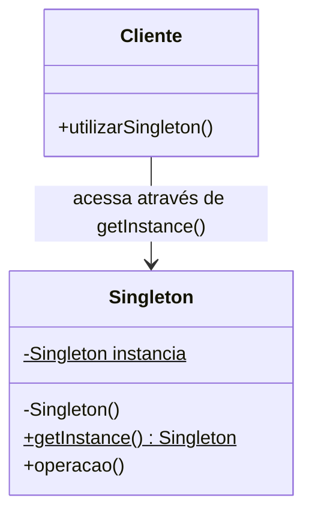

# Padrão de Projeto Singleton

## 1. Introdução

### Nome do padrão
**Singleton**

### Tipo
**Criacional (Creational Design Pattern).**

### Problema que resolve

Em determinadas aplicações, existem situações em que é necessário garantir que uma classe possua apenas uma instância durante toda a execução do programa.

Por exemplo, imagine um sistema que possui diferentes módulos e todos precisam acessar as mesmas configurações da aplicação. Se cada módulo criar seu próprio objeto de configuração, poderão existir várias instâncias armazenando informações que deveriam ser compartilhadas.

Isso pode gerar inconsistências, desperdício de recursos e dificuldades de gerenciamento.

O padrão Singleton resolve esse problema garantindo que uma classe tenha apenas uma instância e oferecendo um ponto de acesso global a esse objeto.

---

## 2. Conceito

### Explicação

O Singleton é um padrão de projeto criacional utilizado quando precisamos garantir que determinada classe tenha somente um objeto instanciado durante a execução da aplicação.

Sua ideia principal é impedir que outras classes criem objetos diretamente por meio do construtor. Para isso, o construtor é declarado como privado (`private`), impossibilitando sua utilização externa.

A própria classe fica responsável por criar e controlar sua única instância, disponibilizando um método público e estático, geralmente chamado `getInstance()`, para que outras partes do sistema possam acessá-la.

Dessa forma, independentemente de quantas vezes o método seja chamado, todos recebem uma referência ao mesmo objeto.

### Quando usar?

O Singleton pode ser utilizado quando:

- É necessário garantir que exista apenas um objeto responsável por determinada funcionalidade.
- Diferentes partes do sistema precisam compartilhar o mesmo recurso.
- É importante centralizar o acesso a um determinado serviço ou configuração.

Alguns exemplos de aplicação são:

- **Gerenciador de configurações:** mantém as configurações gerais da aplicação em um único objeto.
- **Sistema de logging:** centraliza o registro de mensagens e eventos.
- **Gerenciador de cache:** controla o acesso a uma estrutura compartilhada de armazenamento temporário.
- **Gerenciador de recursos:** controla o acesso a determinados recursos compartilhados pela aplicação.

### Vantagens

- **Instância única:** garante que exista apenas um objeto daquela classe.
- **Acesso centralizado:** disponibiliza um ponto de acesso comum para diferentes partes do sistema.
- **Controle da instanciação:** a própria classe controla quando e como seu objeto é criado.
- **Economia de recursos:** evita a criação desnecessária de múltiplos objetos.

### Desvantagens

- **Dependência global:** pode criar um acoplamento entre diferentes partes do sistema, dificultando alterações futuras.
- **Dificuldade nos testes:** como o objeto é compartilhado, pode ser mais difícil isolar testes e substituir suas dependências.
- **Concorrência:** em aplicações com múltiplas threads, é necessário garantir que a criação da instância seja segura, evitando que dois objetos sejam criados simultaneamente.
- **Responsabilidade excessiva:** pode acabar concentrando funcionalidades que deveriam estar distribuídas entre diferentes classes.

---

## 3. Estrutura

### Diagrama simples

O Singleton possui uma estrutura relativamente simples, geralmente composta por uma única classe responsável por controlar sua própria instanciação.



### Explicação das classes e elementos

A estrutura apresentada possui os seguintes elementos:

**1. Singleton**

É a classe que implementa o padrão e controla a criação de sua própria instância.

Ela possui três elementos principais:

- `instancia`: atributo privado e estático que armazena a única instância da classe.
- `Singleton()`: construtor privado, que impede que outras classes criem objetos diretamente.
- `getInstance()`: método público e estático que permite acessar a instância existente ou criá-la caso ainda não exista.

Além disso, a classe pode possuir outros atributos e métodos relacionados à sua responsabilidade.

**2. Cliente**

Representa qualquer classe ou parte do sistema que precisa utilizar o Singleton.

Em vez de criar um novo objeto utilizando `new`, o cliente solicita a instância por meio do método `getInstance()`.

Assim, diferentes clientes conseguem acessar o mesmo objeto.

---

## 4. Exemplo em Java

### Problema real

Imagine um sistema de gerenciamento de uma empresa que possui diferentes módulos, como cadastro de funcionários, controle financeiro e gerenciamento de estoque.

Todos esses módulos precisam consultar algumas configurações gerais da aplicação, como o endereço da API utilizada pelo sistema e o tempo limite das requisições.

Uma solução seria criar um objeto de configuração para cada módulo. Entretanto, isso poderia gerar várias instâncias desnecessárias, dificultando o gerenciamento dessas informações.

Para resolver esse problema, podemos utilizar o padrão Singleton, garantindo que todos os módulos acessem o mesmo gerenciador de configurações.

### Código em Java

```java
public class AppConfig {

    // Classe interna responsável pela criação da instância
    private static class InstanciaHolder {
        private static final AppConfig INSTANCE = new AppConfig();
    }

    // Construtor privado: impede a criação externa de objetos
    private AppConfig() {
    }

    // Método público e estático para acessar a instância
    public static AppConfig getInstance() {
        return InstanciaHolder.INSTANCE;
    }

    // Configurações da aplicação
    public String getApiUrl() {
        return "https://api.empresa.com";
    }

    public int getTimeout() {
        return 30;
    }
}
```

Para demonstrar o funcionamento, podemos utilizar a classe `Main`:

```java
public class Main {

    public static void main(String[] args) {

        // Obtendo a instância do Singleton
        AppConfig config1 = AppConfig.getInstance();

        // Obtendo novamente a mesma instância
        AppConfig config2 = AppConfig.getInstance();

        // Consultando as configurações
        System.out.println("URL da API: " + config1.getApiUrl());
        System.out.println("Timeout: " + config1.getTimeout());

        // Verificando se os objetos são iguais
        System.out.println(
            "As instâncias são iguais? " + (config1 == config2)
        );
    }
}
```

### Saída esperada

```text
URL da API: https://api.empresa.com
Timeout: 30
As instâncias são iguais? true
```

### Explicação do funcionamento

O funcionamento do exemplo pode ser compreendido em algumas etapas:

**1. Construtor privado**

O construtor da classe `AppConfig` foi declarado como `private`. Isso significa que outras classes não conseguem criar uma instância utilizando diretamente o comando `new AppConfig()`.

**2. Criação da instância**

Foi criada uma classe interna chamada `InstanciaHolder`, responsável por armazenar a única instância de `AppConfig`.

O atributo `INSTANCE` é declarado como `static final`, garantindo que a referência armazenada não seja substituída.

Essa abordagem é conhecida como *Initialization-on-demand holder idiom*. Ela permite que a instância seja criada somente quando for solicitada pela primeira vez, aproveitando a inicialização segura de classes do Java para garantir segurança em ambientes com múltiplas threads.

**3. Método getInstance()**

O método `getInstance()` é público e estático, permitindo que qualquer classe acesse a instância sem precisar criar um objeto previamente.

Quando chamado, ele retorna `InstanciaHolder.INSTANCE`.

**4. Compartilhamento da instância**

Na classe `Main`, são criadas duas variáveis, `config1` e `config2`, que recebem o retorno de `getInstance()`.

Apesar de serem duas variáveis diferentes, ambas apontam para o mesmo objeto na memória.

Isso é comprovado pela comparação `config1 == config2`, que retorna `true`, indicando que as duas referências apontam para a mesma instância.

Portanto, o exemplo demonstra como o Singleton centraliza o gerenciamento das configurações e impede a criação de múltiplos objetos dessa classe.

---

## 5. Conclusão

O Singleton é um padrão de projeto criacional que permite controlar a instanciação de uma classe, garantindo que exista apenas um objeto e disponibilizando um ponto de acesso global a ele.

Sua utilização pode trazer benefícios como a centralização de recursos, o compartilhamento de informações e a redução de instâncias desnecessárias.

Entretanto, deve ser aplicado com cuidado, pois o uso excessivo pode aumentar o acoplamento entre as classes e dificultar a manutenção e os testes do sistema.

Na prática, o Singleton pode ser encontrado em aplicações que precisam centralizar determinados serviços, como gerenciadores de configuração, sistemas de logging e controle de recursos compartilhados.

Concluindo, o Singleton é uma solução útil quando a existência de uma única instância é realmente necessária, desde que sua utilização seja adequada à arquitetura e às necessidades da aplicação.

---

## Referências

- REFACTORING.GURU. **Singleton**. Disponível em: https://refactoring.guru/pt-br/design-patterns/singleton. Acesso em: 4 nov. 2026.

- GAMMA, Erich; HELM, Richard; JOHNSON, Ralph; VLISSIDES, John. **Design Patterns: Elements of Reusable Object-Oriented Software**. Addison-Wesley, 1994.
