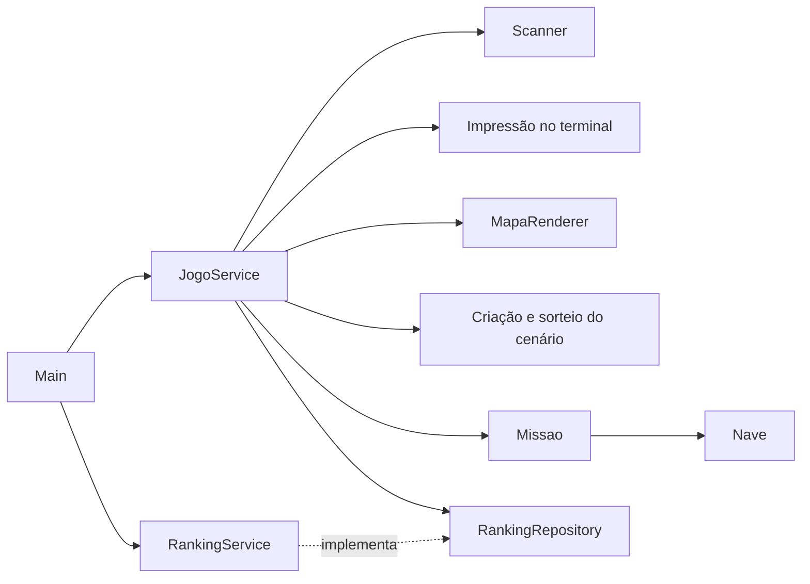
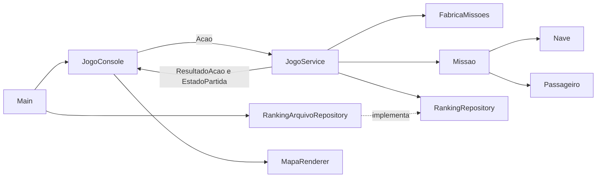
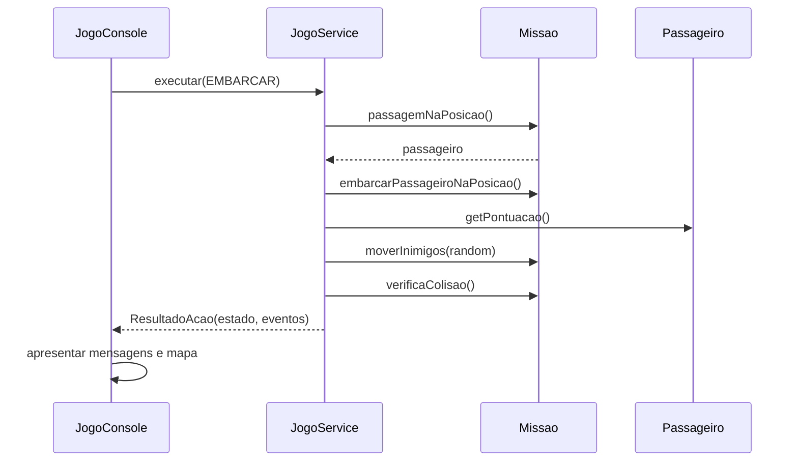

# Fase 1 — Separando regras do jogo e apresentação

## 1. Introdução

O Missão Marte já possuía entidades, herança, polimorfismo e um contrato de
persistência. A transformação desta fase parte da versão SOLID em
[`missao2/src/solidexercicio10/`](../../../../missao2/src/solidexercicio10/),
mantendo o jogo de console e o namespace. O
[Exercício 10 original](../../../../missao2/src/exercicio10/)
continua como referência histórica, com comportamentos diferentes que não serão
misturados automaticamente à base escolhida.

O problema central era o serviço precisar de um terminal para executar as regras.
O resultado é uma API de ações, estado de leitura e eventos, usada pelo console.
As classes existentes foram copiadas e refatoradas; o jogo não foi recriado a
partir de um exemplo de LibGDX. O referencial de Gradle/LibGDX é reservado às
fases seguintes e não foi alterado nem copiado.

## 2. Objetivos de aprendizagem

- Identificar motivos de mudança que pertencem a responsabilidades diferentes.
- Aplicar SRP e DIP em uma aplicação que já funciona.
- Usar Controller, Information Expert, baixo acoplamento e alta coesão do GRASP.
- Extrair uma fábrica simples sem criar abstrações desnecessárias.
- Manter pontuação polimórfica e contratos pequenos.
- Expor dados de leitura sem dar à interface acesso para alterar a partida.
- Testar regras sem teclado, arquivo real de usuário ou espera por tempo real.
- Diferenciar refatoração de alteração de comportamento.

## 3. Conceitos teóricos

**SRP:** uma classe deve agrupar responsabilidades com o mesmo motivo para
mudar. Menu e regras de vitória mudam por razões diferentes. Ter métodos menores
não resolve esse problema se continuarem todos na mesma classe.

**DIP:** o serviço já dependia de `RankingRepository`, não dos detalhes de disco.
Essa separação foi mantida. Relógio e aleatoriedade também podem ser fornecidos
externamente. `LongSupplier` é uma interface padrão suficiente para obter o tempo;
não precisamos criar outra interface própria com a mesma função.

**OCP e LSP:** professor, engenheiro e astronauta continuam sendo tratados como
`Passageiro`. O bônus vem de `getPontuacao()`, sem um `if` por tipo no serviço.
Isso não significa que adicionar uma categoria dispense mudanças na fábrica ou
na apresentação: a proteção se aplica à regra de pontuação já polimórfica.

**ISP:** `Movel`, `Posicionavel` e `RankingRepository` permanecem pequenos. Não
criamos uma interface para cada impressão, nem um framework para ler o console.

**GRASP Controller:** `JogoService` recebe operações da aplicação e coordena
um turno. **Information Expert:** `Nave` continua responsável por capacidade,
posição e vidas; `Missao` continua sabendo quais objetos estão no mapa e como
embarcar ou verificar colisões.

**Fábrica simples:** `FabricaMissoes` concentra a montagem do cenário e seu
sorteio. É a extração de uma responsabilidade de criação, sem uma hierarquia de
Abstract Factory ou uma alegação de que qualquer método criador seja o padrão
GoF Factory Method.

**Dados de leitura:** um record com uma referência a `Missao` continuaria
permitindo alterações indiretas. `EstadoPartida` contém somente valores,
records aninhados e listas copiadas desses valores. Assim, um estado consultado
antes do movimento não muda quando a partida avança.

## 4. Problemas encontrados no código de origem

| Local | Problema observado | Tratamento |
|---|---|---|
| `JogoService.executarLoop(Scanner)` | Serviço controla a interação completa do console. | Loop movido para `JogoConsole`. |
| `jogarPartida()` | Mistura tecla, regra, impressão, tempo e persistência. | Ação explícita e resultado estruturado por turno. |
| `new MapaRenderer()` dentro do serviço | Regra depende de apresentação concreta. | Renderizador fornecido à apresentação em `Main`. |
| Criação de cenário no serviço | Construção compete com a execução da partida. | Extração de `FabricaMissoes`. |
| `Math.random()` e relógio estático | Cenários e tempo difíceis de controlar em testes. | `Random` e `LongSupplier` fornecidos pelo construtor. |
| `Nave.moverComLimites(char, ...)` | Entidade interpreta letras do teclado. | Entidade recebe deslocamentos; console traduz teclas. |
| Getters retornando listas internas | Coleções podem ser alteradas pelos consumidores. | Cópias nas consultas e snapshots na fronteira da interface. |
| Nome `RankingService` | Não explicita ser implementação de persistência. | Renomeado para `RankingArquivoRepository`. |

Antes de alterar, foram caracterizadas as regras da base. São 30/20/15 pontos
iniciais; bônus de 15/20/10 por tipo; custo por tentativa de movimento; três vidas;
vitória apenas com todos embarcados de volta à origem. O ranking da base tem
extensão `.json`, mas linhas delimitadas por `|`. A refatoração não transforma
esse arquivo em JSON nem restaura as regras de ranking do exercício original.

## 5. Arquitetura antes da transformação



A extração do mapa e o contrato do ranking já eram avanços. A dependência do
serviço em relação ao console era a responsabilidade que faltava separar.

## 6. Passo a passo da implementação

Os arquivos ligados abaixo são a implementação completa de referência. Em uma
reprodução manual, faça as extrações na ordem descrita e consulte cada arquivo
para conferir assinaturas, imports e corpos completos. Não implemente tudo de
uma vez: compile a cada conjunto coerente de alterações.

### Passo 1 — Preservar a origem e criar a cópia independente

Após aprovação do plano, crie `fase-01-refatoracao/src/solidexercicio10/` dentro
de `evolucao-missao-marte/fases/`. Copie somente os 18 arquivos `.java` da base,
mantendo seus subdiretórios. Não copie `out`, caches ou rankings. Crie também
`tests/` e `docs/` na fase. Não modifique os fontes da `missao2`.

Nesse momento, antes de qualquer refatoração, compile a cópia. Dentro da fase,
em Bash com um JDK completo:

```bash
mkdir -p out/classes
mapfile -d '' -t fontes < <(find src -type f -name '*.java' -print0)
java -m jdk.compiler/com.sun.tools.javac.Main \
  -encoding UTF-8 -Xlint:all -d out/classes "${fontes[@]}"
java -cp out/classes solidexercicio10.Main
```

Verifique menu, consulta de ranking vazio e saída. Para caracterizar o domínio,
construa uma nave e um professor na mesma posição, embarque e confirme bônus de
15, remoção do mapa e inclusão na tripulação. Verifique também fronteiras,
perda de vidas e o formato de uma gravação temporária do ranking.

### Passo 2 — Introduzir ações e dados de leitura

Crie [Acao.java](../src/solidexercicio10/model/Acao.java). As quatro direções
contêm `dx`/`dy`; embarcar, abortar, inválida e vazia não contêm deslocamento.
Não coloque `w`, `s`, `a` ou `d` nesse enum: essas letras pertencem ao console.

Crie [EstadoPartida.java](../src/solidexercicio10/model/EstadoPartida.java) e
[ResultadoAcao.java](../src/solidexercicio10/model/ResultadoAcao.java). Use os
records aninhados da referência para posição, passageiro e nave. Copie listas
nos construtores compactos, inclusive a lista de passageiros da nave. As
situações são em andamento, vitória, derrota e abortada. Eventos descrevem
embarque, colisão, derrota, retorno à base e outras ocorrências, sem frases.

### Passo 3 — Ajustar as entidades sem mudar as regras

Em [Nave.java](../src/solidexercicio10/model/Nave.java), substitua o parâmetro
`char comando` de `moverComLimites` por `int dx, int dy`. Remova o `switch` de
letras, preservando o cálculo da nova posição e o teste de fronteiras.

Em [Missao.java](../src/solidexercicio10/model/Missao.java), faça
`moverInimigos(Random random)` receber a fonte aleatória e usar
`random.nextInt(3) - 1` em cada eixo. O deslocamento continua em `-1`, `0` ou
`1`, sem introduzir um limite espacial para inimigos. Não há compromisso de
reproduzir a mesma sequência aleatória do gerador global anterior.

Nos getters de coleções de `Missao` e `Nave`, retorne `List.copyOf(...)`.
As operações de alteração continuam nos métodos do domínio. Esses getters
protegem as listas, mas seus elementos ainda são entidades mutáveis; por isso
eles não serão entregues à interface.

### Passo 4 — Extrair a fábrica

Crie [FabricaMissoes.java](../src/solidexercicio10/service/FabricaMissoes.java).
Mova do serviço os métodos `criarNovaMissao`, `posicionarPassageiros`,
`posicionarEntidades`, `sortearPosicaoLivre` e `posicaoOcupada`.
Receba `Random` por construtor e exponha `criar(Dificuldade, int limite)`.

Preserve quantidades, alternância de passageiros, exclusão da origem e limite
de tentativas. Remova o aviso que vinha após o laço de passageiros: o laço só
termina ao atingir a quantidade ou lançar exceção, então aquela condição não
era alcançada. Isso não corrige mapas insuficientes; a exceção permanece.

### Passo 5 — Transformar o serviço em operações por turno

Em [JogoService.java](../src/solidexercicio10/service/JogoService.java), mantenha
os dados da partida em campos, pois eles precisam existir entre chamadas.
Forneça ranking, fábrica, `Random` dos inimigos e relógio no construtor.
O construtor simples fornece as implementações normais de execução.

Implemente estas três operações:

```java
public EstadoPartida iniciar(String piloto, Dificuldade dificuldade, int limite)
public ResultadoAcao executar(Acao acao)
public EstadoPartida consultarEstado()
```

`iniciar` cria uma nova missão e reinicia pontos, movimentos e tempo.
`executar` retorna sem avançar o turno se a ação for vazia ou se a partida já
terminou. Para as outras ações, preserve esta sequência:

1. Aplicar movimento, embarque, aborto ou evento de comando inválido.
2. Mover os inimigos.
3. Verificar colisões e retirar no máximo uma vida por turno com colisão.
4. Verificar pontos zerados, se a partida ainda estiver ativa.
5. Verificar todos embarcados e retorno à origem, se ainda estiver ativa.
6. Retornar fotografia e eventos.

Assim, derrota por colisão ou combustível tem precedência sobre vitória.
Até aborto e comando inválido passam pelas etapas de inimigos e colisão, como
na base. Não coloque um `return` antecipado depois do aborto para “melhorar”
essa regra sem uma alteração aprovada de comportamento.

Em `consultarEstado`, converta as entidades para os records de leitura. No
encerramento, guarde o instante final: consultar depois não deve aumentar a
duração. A gravação da vitória ocorre uma vez; chamadas posteriores não jogam
novamente. Mantenha operações de listar, limpar e registrar pontuação delegando
ao contrato do ranking.

### Passo 6 — Extrair o console e adaptar o mapa

Crie [JogoConsole.java](../src/solidexercicio10/presentation/JogoConsole.java).
Mova menus, prompts, estatísticas, tradução de comandos e mensagens para ele.
Receba serviço, `Scanner`, `PrintStream` e renderizador pelo construtor. O console
tem o loop; cada iteração chama uma ação do serviço e apresenta seu resultado.

Em `lerLinha`, imprima e faça flush do prompt antes de esperar entrada.
Verifique `scanner.hasNextLine()`: se não houver linha, retorne `null` e encerre
a interação. Faça essa checagem também durante nome, dificuldade, tamanho e
confirmação de decolagem. Uma linha vazia mantém os padrões anteriores; durante
a partida, vira `Acao.VAZIA`.

Adapte [MapaRenderer.java](../src/solidexercicio10/presentation/MapaRenderer.java)
para receber `EstadoPartida` e escrever no `PrintStream` fornecido. Preserve
prioridades e símbolos: nave, plataforma, passageiros, asteroides e inimigos.
O desenho continua sendo texto, não uma nova interface gráfica.

### Passo 7 — Nomear a persistência e compor a aplicação

Renomeie a cópia de `RankingService.java` para
[RankingArquivoRepository.java](../src/solidexercicio10/repository/RankingArquivoRepository.java),
alterando classe e construtor. Preserve o conteúdo de leitura/escrita e o
contrato [RankingRepository](../src/solidexercicio10/repository/RankingRepository.java).
Não converta o arquivo para JSON e não limite a persistência às cinco entradas.

Em [Main.java](../src/solidexercicio10/Main.java), crie repositório, serviço,
scanner, saída e renderizador, e inicie `JogoConsole`. Isso é composição
explícita por construtores, sem framework de injeção.

### Passo 8 — Criar o script e os testes da versão final

Use [executar.sh](../executar.sh) como referência completa. Ele aceita
`compilar`, `testar` ou `jogar`, localiza sua própria pasta e compila somente os
fontes e testes locais. O compilador usa `-Xlint:all -Werror`. O diretório de
trabalho do jogo é a fase, isolando o ranking.

Implemente [TestesFase01.java](../tests/solidexercicio10/tests/TestesFase01.java).
O repositório em memória fica apenas nos testes. A fábrica de teste fornece uma
nova missão conhecida em cada início; `RandomFixo` controla os inimigos e o
relógio fornecido permite simular 12 segundos sem esperar. As verificações
lançam `AssertionError`, de modo que não dependem de uma biblioteca de testes.

## 7. Código antes e depois

No serviço anterior, pontuação e impressão aconteciam juntas:

```java
if (embarcou) {
    score += passageiro.getPontuacao();
    System.out.printf("Passageiro %s embarcado com sucesso! +%d pontos!%n",
            passageiro.getNome(), passageiro.getPontuacao());
}
```

No método `embarcar` atual, a regra gera um fato:

```java
} else if (missao.embarcarPassageiroNaPosicao()) {
    pontos += passageiro.getPontuacao();
    eventos.add(new Evento(TipoEvento.EMBARCOU,
            passageiro.getNome(), passageiro.getPontuacao()));
}
```

O console decide a mensagem em `exibirEvento`:

```java
case EMBARCOU -> saida.printf(
    "Passageiro %s embarcado com sucesso! +%d pontos!%n",
    evento.nome(), evento.valor());
```

A interface anterior do serviço exigia o console:

```java
jogoService.executarLoop(scanner);
```

A atual pode ser usada sem terminal:

```java
var estado = jogo.iniciar("Ana", Dificuldade.FACIL, 5);
var resultado = jogo.executar(Acao.DIREITA);
int pontos = resultado.estado().pontos();
```

Não execute o último trecho presumindo vitória ou uma posição de passageiro:
o cenário normal é aleatório. Para validar um resultado específico, forneça a
fábrica controlada usada nos testes.

## 8. Explicação das alterações

O serviço continua coordenando regras; movê-las para o console apenas mudaria
o lugar do acoplamento. O console sabe que `c` significa embarcar, mas não decide
quantos pontos o embarque vale. O modelo mantém essa informação no passageiro.

A fábrica reúne mudanças de construção do cenário. O relógio e o sorteio
fornecidos permitem testar sem entrada humana, espera ou sorte. Usar as classes
padrão do Java foi suficiente, sem criar interfaces equivalentes sem benefício.

Os snapshots têm custo de alocação, aceitável neste jogo de turnos e mapa
pequeno. Em troca, uma interface não pode chamar `mover()` no estado recebido ou
limpar a lista da missão. Records isolam a leitura; não transformam o domínio
inteiro em objetos imutáveis.

A gravação continua síncrona e ocorre antes de o resultado da vitória ser
devolvido ao console. Falhas de gravação ainda são propagadas pelo repositório;
não foi criada uma política nova de recuperação. O tratamento de fim de entrada
foi a alteração de interação prevista e aprovada.

## 9. Arquitetura resultante





O diagrama de sequência mostra um embarque válido e não detalha todos os ramos
de derrota ou vitória. A ordem completa está no método `executar`.

## 10. Como executar e testar

Dentro da fase:

```bash
bash executar.sh compilar
bash executar.sh testar
bash executar.sh jogar
```

Resultado da suíte: `PASSOU: 162 verificações da Fase 1.`
Foi usada a distribuição OpenJDK 25.0.5.0.3 disponível. O Java 17 não foi
executado, nem foi feita compilação com `--release 17`, indisponível nesta
distribuição. As classes geradas correspondem ao compilador em uso.

| Grupo | Evidência verificada |
|---|---|
| Movimento | Quatro direções, quatro bordas, custo e contagem por tentativa. |
| Embarque | Vazio, capacidade, três bônus polimórficos e transferência de passageiro. |
| Encerramento | Colisões com ambos os perigos, vidas zeradas, combustível e precedência sobre vitória. |
| Turnos | Vazio não move; inválido e aborto movem; partida encerrada ignora ações. |
| Vitória | Todos longe da base não vencem; retorno salva uma vez, com tempo e passageiros. |
| Leitura | Listas protegidas e fotografia antiga sem alteração após mover. |
| Criação | Semente repetível, quantidades, posições livres e falhas de geração preservadas. |
| Arquivo | Ordenação, campos, leitura de formato legado, append e limpeza em diretório temporário. |
| Console | Vitória completa roteirizada, menu, mapa, mensagens, ranking, reset, padrões e fim de entrada. |

Também houve inspeção interativa no terminal, com mapa de tamanho 3,
movimentação, tentativa de embarque vazio, retorno, aborto e saída. A fase foi
copiada para um diretório temporário com espaços e compilada/testada sem outras
pastas do repositório. Os arquivos protegidos foram conferidos por hash.

Não houve vitória manual em uma partida aleatória. A vitória foi validada nos
cenários automatizados conhecidos. Não existem interface gráfica, servidor ou
versão Android nesta fase, portanto esses testes não se aplicam.

Para conferir a separação, busque `Scanner`, `System.out` e `presentation` em
`service/` e `model/`: não devem existir dependências desse tipo. Confirme também
que `MapaRenderer` usa `EstadoPartida`, sem receber uma `Missao` mutável.

## 11. Exercícios para os alunos

1. Mude a tecla de embarque na apresentação e explique por que a regra de bônus
   não precisa ser alterada. Reexecute a suíte após ajustar o teste de console.
2. Construa um cenário em que o combustível zera ao retornar à base e explique
   por que a derrota tem precedência. Localize esse caso na suíte.
3. Crie uma nova categoria de passageiro e separe as mudanças necessárias em
   pontuação, geração e apresentação. Discuta os limites da afirmação de OCP.
4. Experimente alterar a lista de um `EstadoPartida`. Explique a exceção e por
   que apenas tornar o campo `final` não protegeria uma lista mutável.
5. Proponha uma correção para mapa insuficiente ou movimento após aborto.
   Identifique como ela mudaria o comportamento e quais testes precisariam de
   nova expectativa. Não trate a mudança como uma simples refatoração.
6. Analise como apresentar um evento `EMBARCOU` em uma interface gráfica, sem
   implementar LibGDX ou iniciar outra fase.

As extensões são atividades propostas; não foram implementadas nesta entrega.

## 12. Conclusão

A Fase 1 mantém o jogo de console e suas regras, aproveitando as entidades e o
contrato de ranking existentes. A mudança é poder executar as regras sem depender
do terminal, com ações, snapshots e eventos. A separação foi validada por testes
e execução independente, deixando a migração de build para a Fase 2.

Permanecem limitações do legado: mapa insuficiente, sorteio com tentativas,
inimigos sem fronteiras, movimento após aborto e persistência delimitada com
tratamento limitado de dados inválidos. Alterá-las exige uma decisão explícita
de comportamento; elas não foram escondidas dentro desta refatoração.
