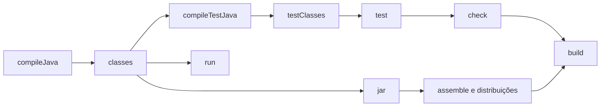

# Fase 2 — Construindo, testando e executando com Gradle

## 1. Introdução

Esta fase transforma a construção do projeto de console da Fase 1 em um build
Gradle. O jogo permanece o mesmo: seus 23 fontes de produção e a suíte original
foram copiados sem alteração de conteúdo. A evolução está na estrutura de
diretórios, na declaração de ferramentas/dependências e na automação do build.

O [plano aprovado](../../../docs/plano-fase-02.md) define o escopo. O
[referencial API, Gradle e libGDX](../../../tutorial-api-gradle-libgdx.md) é a
base teórica, somente leitura. Seus exemplos gráficos não substituem nossas
classes ou regras. O pacote permanece `solidexercicio10` e a entrada continua
sendo `solidexercicio10.Main`.

## 2. Objetivos de aprendizagem

- Entender build tool, API, plugin, tarefa e dependência.
- Configurar um projeto Java com Groovy DSL e layout padrão.
- Diferenciar o Java que executa Gradle da toolchain usada pelo build.
- Executar as verificações existentes por JUnit, com relatório verificável.
- Usar Wrapper para padronizar a versão da ferramenta na equipe.
- Diferenciar `build`, `run`, compilação, testes e distribuição.
- Interpretar DAG de tarefas, daemon, `UP-TO-DATE` e caches.
- Migrar sem alterar as regras e preservando as fases anteriores.

## 3. Conceitos teóricos

### API, build tool e comparação com Maven

Nas seções **O que é uma API?** e **O que é um Build Tool?** do
[referencial](../../../tutorial-api-gradle-libgdx.md), API representa um contrato
de uso e build tool representa a automação para preparar o software. O Gradle
não substitui a API `RankingRepository`: configura a construção e a execução
da aplicação que utiliza esse contrato.

As seções **História e Origem do Gradle**, **Versões do Gradle** e **Gradle vs
Maven** contextualizam sua evolução e a alternativa Maven. Ambos automatizam
dependências, compilação e testes. Maven usa principalmente `pom.xml`; aqui
usamos scripts Groovy no Gradle. A escolha prepara a continuação com LibGDX,
sem introduzi-lo antecipadamente.

O Gradle 8.7 foi escolhido para acompanhar o plano e o referencial; não está
sendo apresentado como a versão mais recente ou como uma versão “LTS”.

### Tarefas, DAG e ciclo de vida

As seções **Tasks (Tarefas)**, **DAG – Grafo Acíclico Direcionado** e **Ciclo de
Vida de um Build Gradle** explicam a execução. Gradle inicializa o build, configura
o projeto e executa as tarefas necessárias. Pedir uma tarefa pode acionar suas
dependências: executar `test` exige classes de aplicação e de teste compiladas.



É uma visão simplificada: recursos e tarefas auxiliares também fazem parte do
grafo. Observe que `run` não depende de `test` e `build` não depende de `run`.

### Daemon e caches

**Gradle Daemon**, **Build Cache (Cache de Build)** e **Configuration Cache**
do [referencial](../../../tutorial-api-gradle-libgdx.md) tratam de mecanismos
diferentes. O daemon mantém uma JVM para reduzir custo de inicialização.
`--no-daemon` pode usar um daemon de uso único, conforme as opções da JVM.

`UP-TO-DATE` significa que entradas e saídas daquela tarefa não mudaram desde a
execução anterior. `FROM-CACHE` indica recuperação de resultados do build cache.
O cache de dependências guarda bibliotecas baixadas; configuration cache guarda
o resultado da configuração do build. Nesta fase não ativamos build cache ou
configuration cache: o segundo build demonstra verificações de atualização.

### DSL, plugins e dependências

As seções **DSL: Groovy vs Kotlin**, **Estrutura de um `build.gradle`** e
**Dependências e seus Escopos** orientam a configuração. A Groovy DSL descreve
plugins e tarefas, sem exigir que o código do jogo seja escrito em Groovy.
Plugin adiciona capacidades ao build; dependência fornece bibliotecas a um
classpath. Os plugins usados aqui são distribuídos com o próprio Gradle.

## 4. Problemas encontrados no projeto de origem

| Situação da Fase 1 | Necessidade na migração |
|---|---|
| `executar.sh` reúne arquivos e chama o compilador. | Declarar compilação e execução de modo reconhecido por Gradle/IDE. |
| Suíte com `main`, sem framework de testes. | Adaptar sua entrada para a tarefa `test`, preservando as verificações. |
| `src/` e `tests/` próprios. | Adotar `src/main/java` e `src/test/java`. |
| Cada máquina pode escolher ferramentas diferentes. | Fixar Gradle pelo Wrapper e toolchain Java 17. |
| Ranking depende do diretório atual. | Fixar o diretório da tarefa `run` na nova fase. |
| Ausência de distribuição com scripts próprios. | Usar as tarefas do plugin `application`. |

O script anterior funciona e não era um defeito das regras do jogo. A migração
centraliza sua automação e prepara o gerenciamento de dependências futuras.

## 5. Arquitetura antes da transformação

```text
fase-01-refatoracao/
├── executar.sh
├── src/solidexercicio10/
└── tests/solidexercicio10/tests/TestesFase01.java
```

O script compilava aplicação e testes em `out/classes`, usando UTF-8,
`-Xlint:all -Werror`. Depois executava `Main` ou a suíte. As entidades, serviço,
console e repositório já estavam separados; essa arquitetura foi reaproveitada.

## 6. Passo a passo da implementação

### Passo 1 — Criar a nova versão sem modificar a origem

Após aprovação, crie `fase-02-gradle/` ao lado da Fase 1. Copie apenas os `.java`:
os de `src/` para `src/main/java/` e os de `tests/` para `src/test/java/`.
Não copie rankings, `out/`, caches, documentos ou o script de compilação antigo.

As subpastas dos pacotes continuam iguais. Por exemplo,
`src/solidexercicio10/service/JogoService.java` passa a
`src/main/java/solidexercicio10/service/JogoService.java`. O `package` não muda.

### Passo 2 — Nomear o projeto

Crie [settings.gradle](../settings.gradle):

```groovy
rootProject.name = 'missao-marte-fase-02'
```

Esse é o nome do projeto no build e será usado em artefatos e scripts gerados.
Não há `include` de outras fases. **Projeto Multi-módulo (libGDX)**, do referencial,
fica somente como prévia da Fase 3.

### Passo 3 — Configurar plugins e compilação

Crie [build.gradle](../build.gradle), cuja implementação completa está no link.
Comece pelos plugins:

```groovy
plugins {
    id 'java'
    id 'application'
}
```

`java` fornece compilação, testes e JAR. `application` fornece `run`, scripts de
inicialização e distribuições. Ele já aplica Java implicitamente; declarar ambos
deixa explícitas as capacidades desta etapa.

Configure Java:

```groovy
java {
    toolchain {
        languageVersion = JavaLanguageVersion.of(17)
    }
}

tasks.withType(JavaCompile).configureEach {
    options.release = 17
    options.encoding = 'UTF-8'
    options.compilerArgs += ['-Xlint:all', '-Werror']
}
```

A toolchain seleciona JDK 17 para as tarefas Java. `--release 17` restringe
linguagem, APIs da plataforma e bytecode ao Java 17. UTF-8 padroniza a leitura dos
fontes. `-Xlint:all` ativa avisos do compilador e `-Werror` os transforma em falha.
`configureEach` aplica as opções às tarefas desse tipo, inclusive aos testes.

O Gradle 8.7 também deve ser iniciado por um runtime compatível. Neste ambiente
selecionamos JDK 17 por `JAVA_HOME`; a toolchain não corrige um Gradle iniciado
em Java 25. Não grave caminhos absolutos desta máquina no build versionado.

### Passo 4 — Declarar dependências de testes

```groovy
repositories {
    mavenCentral()
}

dependencies {
    testImplementation platform('org.junit:junit-bom:5.10.2')
    testImplementation 'org.junit.jupiter:junit-jupiter'
    testRuntimeOnly 'org.junit.platform:junit-platform-launcher'
}
```

`mavenCentral()` é o repositório de obtenção de bibliotecas. O BOM alinha as
versões dos componentes JUnit. Jupiter oferece a API e o mecanismo dos testes;
o launcher entra no classpath de execução dos testes. `testImplementation`
disponibiliza bibliotecas para compilar e executar testes; `testRuntimeOnly`
somente para sua execução. A aplicação não recebe dependências externas.

Não é preciso declarar `implementation` de LibGDX: a Fase 2 continua no console.
Também não usamos `api`, que pertence ao plugin Java Library. Explique os escopos
do referencial sem adicionar bibliotecas desnecessárias ao projeto.

### Passo 5 — Adaptar a suíte existente

Mantenha [TestesFase01.java](../src/test/java/solidexercicio10/tests/TestesFase01.java)
e crie [RegrasJogoTest.java](../src/test/java/solidexercicio10/tests/RegrasJogoTest.java):

```java
package solidexercicio10.tests;

import org.junit.jupiter.api.DisplayName;
import org.junit.jupiter.api.Test;

class RegrasJogoTest {
    @Test
    @DisplayName("Executa as 162 verificações herdadas da Fase 1")
    void executarVerificacoesExistentes() throws Exception {
        TestesFase01.main(new String[0]);
    }
}
```

Adicione ao build:

```groovy
tasks.named('test', Test) {
    useJUnitPlatform()
    testLogging {
        events 'passed', 'skipped', 'failed'
        showStandardStreams = true
    }
}
```

O adaptador é um teste real reconhecido pelo JUnit. Se a suíte lançar uma falha,
ela se propaga e faz `test` falhar. O relatório terá **um teste JUnit com 162
verificações internas**, não 162 métodos individuais. A saída padrão é mostrada
para permitir conferir o resultado da suíte preservada. `build` inclui `test`.

Essa adaptação é complementada pelo [guia oficial do JUnit 5.10.2](https://docs.junit.org/5.10.2/user-guide/#running-tests-build-gradle),
pois o referencial não especifica como integrar uma suíte com `main`.

### Passo 6 — Configurar a execução interativa

```groovy
application {
    mainClass = 'solidexercicio10.Main'
}

tasks.named('run', JavaExec) {
    standardInput = System.in
    workingDir = layout.projectDirectory.asFile
}
```

`mainClass` identifica a entrada da aplicação. `standardInput` encaminha as
linhas digitadas ao `Scanner`; sem essa ligação, a aplicação iniciada pela tarefa
pode receber fim de entrada. `workingDir` fixa o diretório da fase para que o
ranking relativo seja lido e escrito aqui, preservando os arquivos anteriores.

`run` compila o necessário e abre o jogo, sem executar automaticamente os testes.
`build` compila, testa e empacota, sem abrir uma partida. Esse é o motivo de haver
comandos separados para verificar o projeto e para jogar.

### Passo 7 — Gerar o Wrapper oficial

Declare a versão e o checksum no build:

```groovy
tasks.named('wrapper', Wrapper) {
    gradleVersion = '8.7'
    distributionType = Wrapper.DistributionType.BIN
    distributionSha256Sum = '544c35d6bd849ae8a5ed0bcea39ba677dc40f49df7d1835561582da2009b961d'
}
```

Na pasta da fase, com JDK 17 selecionado, execute uma vez `gradle wrapper` usando
a instalação 8.7. Depois passe a usar `./gradlew`. Versione `gradlew`,
`gradlew.bat`, `gradle-wrapper.jar` e `gradle-wrapper.properties`.

| Propriedade gerada | Finalidade |
|---|---|
| `distributionUrl` | ZIP oficial do Gradle 8.7, distribuição binária. |
| `distributionSha256Sum` | Verificar o conteúdo baixado contra o checksum aprovado. |
| `distributionBase` e `distributionPath` | Onde extrair a distribuição no Gradle User Home. |
| `zipStoreBase` e `zipStorePath` | Onde guardar o ZIP da distribuição. |
| `networkTimeout` | Timeout de rede em milissegundos; gerado como 10000. |
| `validateDistributionUrl` | Habilitar validação da URL na geração do Wrapper. |

O checksum do JAR gerado é
`cb0da6751c2b753a16ac168bb354870ebb1e162e9083f116729cec9c781156b8`.
Ambos foram conferidos na [referência oficial de checksums](https://gradle.org/release-checksums/).
O Wrapper baixa Gradle quando necessário; ele não instala o JDK. Na primeira
execução também podem ser necessários downloads das dependências JUnit.

### Passo 8 — Conferir arquivos gerados e integração com a IDE

O [.gitignore](../.gitignore) exclui `.gradle/`, `build/`, `out/`, `.class` e o
ranking local. O JAR do Wrapper é uma ferramenta versionada e fica incluído.
Não ignore todos os JARs indiscriminadamente sem preservar esse arquivo.

Siga **Visão Geral do Ambiente**, **Passo 1 – Instalar o JDK 17**, **Passo 2 –
Instalar o Visual Studio Code**, **Passo 3 – Instalar as Extensões no VS Code**,
**Passo 4 – Instalar o Gradle (Opcional)** e **Passo 5 – Abrir o Projeto no VS Code**
do [referencial](../../../tutorial-api-gradle-libgdx.md), adaptando os comandos
Windows para Linux. Abra diretamente a pasta desta fase e importe seu build.
Selecione JDK 17 para Gradle, sem incluir outras versões como fontes do mesmo
projeto. O namespace igual nas versões preservadas exige esse isolamento.

## 7. Código antes e depois

Antes, o script reunia arquivos e invocava diretamente o compilador:

```bash
mapfile -d '' -t fontes < <(find src tests -type f -name '*.java' -print0)
"${compilador[@]}" -encoding UTF-8 -Xlint:all -Werror -d out/classes "${fontes[@]}"
```

Agora a organização dos diretórios e o plugin Java definem os conjuntos de
fontes. As mesmas exigências de compilação ficam declaradas no bloco
`tasks.withType(JavaCompile).configureEach`, mostrado acima.

Antes, os testes eram iniciados diretamente:

```bash
java -ea -cp out/classes solidexercicio10.tests.TestesFase01
```

Agora o comando é:

```bash
./gradlew test
```

Ele prepara os classpaths, compila aplicação/testes e inicia o JUnit, cujo
adaptador chama o mesmo `main`. Nenhuma regra do `JogoService` foi reescrita.

## 8. Explicação das alterações

A mudança segue convenções para reduzir configuração: `src/main/java` e
`src/test/java` são reconhecidos pelo plugin. Não precisamos personalizar
`sourceSets` para manter os diretórios antigos. Os pacotes do código permanecem.

O adaptador reaproveita o investimento nos testes e oferece relatório padrão.
Uma futura decomposição em testes menores pode melhorar o diagnóstico, mas não
é necessária para a migração aprovada. O domínio não passa a depender de JUnit.

A escolha de Java 17 e Gradle 8.7 acompanha o referencial, usando o JDK encontrado
e verificado. O projeto não registra caminhos absolutos do desenvolvedor. O
Wrapper fixa a versão do Gradle; toolchain e `--release` controlam a compilação.

O tutorial de referência usa exemplos de LibGDX e launcher em outro pacote. Aqui
usamos Groovy, um projeto único e `solidexercicio10.Main`. Não foram copiados
`core`, `lwjgl3`, dependências gráficas ou a lógica simplificada daqueles exemplos.

## 9. Arquitetura resultante

```text
fase-02-gradle/
├── settings.gradle
├── build.gradle
├── gradlew / gradlew.bat
├── gradle/wrapper/
├── src/main/java/solidexercicio10/
│   ├── Main.java
│   ├── model/
│   ├── service/
│   ├── presentation/
│   └── repository/
├── src/test/java/solidexercicio10/tests/
│   ├── TestesFase01.java
│   └── RegrasJogoTest.java
└── docs/fase-02-tutorial.md
```

A arquitetura do jogo permanece a da Fase 1. Gradle coordena a construção por
fora dela. JUnit e a suíte ficam somente no conjunto de fontes de testes.

## 10. Como executar e testar

Na raiz do repositório, usando o JDK 17 deste ambiente Ubuntu:

```bash
export JAVA_HOME=/usr/lib/jvm/java-17-openjdk-amd64
export PATH="$JAVA_HOME/bin:$PATH"
cd evolucao-missao-marte/fases/fase-02-gradle
./gradlew --version
./gradlew tasks
./gradlew clean build
./gradlew test --rerun-tasks
./gradlew run --console=plain
./gradlew installDist
./gradlew distZip
```

Adapte o caminho do JDK em outras máquinas. **Comandos Gradle Essenciais**,
**Executando o Jogo no VS Code** e **Parte 9 – Executando e Testando**, no
[referencial](../../../tutorial-api-gradle-libgdx.md), fundamentam terminal,
painel Gradle e depuração. Aqui a tarefa é `run`, sem o prefixo `lwjgl3:`.

Confira o relatório em `build/reports/tests/test/index.html` e o XML em
`build/test-results/test/`. Não basta ler `BUILD SUCCESSFUL`: confirme o teste
executado e a saída das 162 verificações. Tarefas de recursos aparecem como
`NO-SOURCE` porque não há recursos separados; isso não significa que os testes
foram executados e nem substitui a conferência do relatório.

O build inicial concluiu compilação, testes e distribuição. A execução forçada
de testes confirmou 1 teste JUnit aprovado e 162 verificações. O segundo build
mostrou compilação e testes `UP-TO-DATE`. A configuração `runtimeClasspath`
não possui bibliotecas externas; JUnit ficou fora do JAR e do ZIP do jogo.

`run` foi validado a partir de outro diretório com `-p`: listou/limpou um ranking
de teste na Fase 2, iniciou missão, desenhou mapa, abortou e saiu. Os rankings
anteriores foram preservados. O script da distribuição também iniciou o jogo.
Uma cópia desta fase, em diretório com espaços, compilou e executou com
`--offline`, usando os downloads já armazenados em cache, sem outras fases.

Os testes foram realizados em Linux com Java 17.0.21.0.3. O Gradle emitiu um
aviso ao inspecionar `/usr/lib/jvm/openjdk-17`, diretório sem executável Java,
mas encontrou e usou o JDK completo em `java-17-openjdk-amd64`; a compilação
Java passou com avisos tratados como erro. Neste executor foi necessária
permissão para abrir o socket local do daemon, bloqueado pelo sandbox.

Não foi executado Windows, uma partida aleatória manual completa ou qualquer
interface gráfica/servidor/Android. Esses limites não foram apresentados como
testes aprovados. A vitória continua coberta pelos cenários automatizados.

## 11. Exercícios para os alunos

1. Execute `build` e `run` e identifique quais tarefas aparecem em cada comando.
2. Localize o relatório e explique por que existe um teste JUnit para 162 verificações.
3. Explique a diferença entre toolchain, `--release` e o Java que inicia Gradle.
4. Execute dois builds e diferencie `UP-TO-DATE` de `FROM-CACHE`.
5. Consulte `dependencies --configuration runtimeClasspath` e depois
   `dependencies --configuration testRuntimeClasspath`; explique a diferença.
6. Localize a versão do Wrapper e o checksum. Explique por que seus arquivos
   entram no Git, mas `.gradle/` e `build/` ficam fora.
7. Compare o mesmo `JogoService.java` nas Fases 1 e 2 e confirme que a migração
   de build não exigiu alterar as regras.

## 12. Conclusão

O jogo agora tem construção, teste, execução e distribuição padronizados por
Gradle 8.7. O Wrapper permite repetir a versão da ferramenta, a configuração
mantém Java 17 e o adaptador JUnit executa a suíte existente com relatório.

Os fontes do domínio e suas limitações funcionais foram preservados. A próxima
fase pode partir deste projeto para introduzir LibGDX, após planejamento e
aprovação próprios. Ela não foi iniciada nesta entrega.
