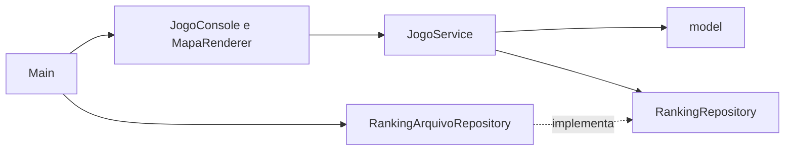
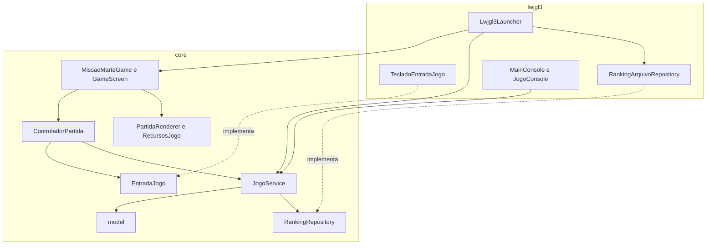

# Fase 3 — Do console ao ciclo de vida LibGDX

## 1. Introdução

A Fase 2 já separava regras e terminal. Agora introduzimos uma janela LibGDX
reutilizando `JogoService`, as entidades e os contratos existentes. Seguimos os
dois módulos do [referencial](../../../tutorial-api-gradle-libgdx.md): core e
lwjgl3. A aprovação do usuário substituiu a proposta anterior de três módulos.

Esta etapa implementa a estrutura do framework e uma tela inicial com quatro
imagens existentes. A interface completa é assunto da Fase 4. A cada etapa,
copiam-se os fontes necessários da fase anterior para um projeto independente.

## 2. Objetivos de aprendizagem

- Distinguir módulo Gradle de pacote Java e de backend.
- Entender ApplicationListener, Game, Screen e seus ciclos de vida.
- Conectar a entrada gráfica a regras já testadas sem duplicá-las.
- Desenhar um estado imutável usando SpriteBatch e texturas.
- Configurar dependências, recursos e distribuição em dois subprojetos.
- Validar regras sem OpenGL e renderização com uma janela real.

## 3. Conceitos teóricos

O referencial contribui com **Parte 3 — A API LibGDX**, **Projeto Multi-módulo**
da Parte 2, **Parte 5 — Arquitetura do Jogo**, **Parte 6 — Implementação do Jogo**
e **Parte 8 — Configuração do build.gradle**. Consulte essas seções pelo título,
pois a numeração de algumas subseções do material se repete.

LibGDX é uma biblioteca Java para aplicações gráficas que compartilham código
entre backends. O backend lwjgl3 cria a janela desktop e o contexto gráfico;
a API comum oferece Game, Screen, SpriteBatch, texturas, entrada e arquivos.
Gradle resolve as dependências e organiza os módulos.

O backend controla o loop: chama `render()` repetidamente. A aplicação não deve
abrir um `while` de console nem esperar Scanner nesse método. Um frame é uma
oportunidade de desenhar; neste jogo, um turno só acontece ao receber uma ação.

| Método | Responsabilidade nesta fase |
|---|---|
| `Game.create()` | Criar recursos e selecionar a primeira tela. |
| `Screen.show()` | Ativar a coordenação da tela. Screen não possui create(). |
| `Screen.render(delta)` | Consultar entrada, atualizar apresentação e desenhar. |
| `resize(width,height)` | Ajustar viewport/câmera, mantendo coordenadas virtuais. |
| `pause()` / `resume()` | Suspender/retomar a coordenação de entrada. |
| `hide()` | Desativar a tela, sem presumir descarte automático. |
| `dispose()` | Liberar os recursos cujo dono é aquela instância. |

`Game.render()` encaminha para a Screen ativa. Por isso MissaoMarteGame herda
esse comportamento em vez de substituí-lo por outro loop. `Game.dispose()`
esconde a tela, mas o nosso Game chama explicitamente o descarte da tela.

Fontes oficiais complementares:

- [Ciclo de vida](https://libgdx.com/wiki/app/the-life-cycle).
- [Game e Screen](https://libgdx.com/wiki/start/simple-game-extended).
- [Gestão de assets](https://libgdx.com/wiki/managing-your-assets).
- [Viewports](https://libgdx.com/wiki/graphics/viewports).
- [Arquivos e plataformas](https://libgdx.com/wiki/file-handling).

## 4. Problemas encontrados no código original

A base desta fase é a Fase 2, já refatorada. Ela não tem janela, backend,
texturas, câmera ou callbacks gráficos. Seu `Main` inicia um fluxo de terminal
que espera comandos bloqueantes. Esse fluxo não pode ser colocado em render().

A base já resolve outra parte do problema: o serviço não desenha o mapa e
aceita `Acao`. Portanto não precisamos substituir Nave, Missao ou JogoService
pelas entidades simplificadas do tutorial.

Os pacotes ainda se chamam `solidexercicio10`. A migração solicitada para
`br.unifor.missaomarte` exige atualização consistente de package/import em fontes
e testes. As pastas anteriores não são modificadas.

## 5. Arquitetura antes da transformação



Tudo pertence a um projeto Gradle. O console traduz as teclas e o serviço
devolve estado/eventos. A implementação de arquivo é montada no Main.

## 6. Passo a passo da implementação

### 6.1. Preparar uma cópia independente

Criar `fase-03-libgdx` após aprovação. Copiar o Wrapper oficial da Fase 2,
incluindo seu JAR e permissões do gradlew. Copiar fontes e testes, não build,
caches ou rankings. Criar `core` e `lwjgl3` com estrutura `src/main/java`.

Mover model, service e contratos para
`core/src/main/java/br/unifor/missaomarte/`. Substituir o prefixo de namespace
em package/import sem alterar os métodos das regras. Colocar persistência de
arquivo e console nos pacotes correspondentes de lwjgl3. Renomear o antigo Main
para MainConsole e atualizar seus imports.

### 6.2. Declarar os módulos e versões

O [settings.gradle](../settings.gradle) identifica os subprojetos:

```groovy
rootProject.name = 'missao-marte-fase-03'
include 'core', 'lwjgl3'
```

O [build raiz](../build.gradle) concentra a versão `gdxVersion = '1.12.1'`,
Maven Central, toolchain/release Java 17, UTF-8, `-Xlint:all -Werror` e JUnit.
`subprojects` aplica essas configurações aos dois módulos; a raiz coordena o
build, sem possuir fontes de produção. `clean build` executa as tarefas dos
subprojetos. O Wrapper permanece 8.7 com checksum oficial da distribuição BIN.

No [core/build.gradle](../core/build.gradle):

```groovy
plugins { id 'java-library' }
dependencies {
    api "com.badlogicgames.gdx:gdx:$gdxVersion"
}
```

`java-library` oferece api/implementation. Usamos `api` porque o tipo público
MissaoMarteGame estende Game: quem compila o launcher precisa enxergar esse tipo
LibGDX. Isso não significa adicionar imports gráficos às regras.

No [lwjgl3/build.gradle](../lwjgl3/build.gradle):

```groovy
dependencies {
    implementation project(':core')
    implementation "com.badlogicgames.gdx:gdx-backend-lwjgl3:$gdxVersion"
    runtimeOnly "com.badlogicgames.gdx:gdx-platform:$gdxVersion:natives-desktop"
}
sourceSets.main.resources.srcDir rootProject.file('core/assets')
```

`application` cria run, scripts e distribuições. `implementation` permite ao
desktop usar o core/backend; `runtimeOnly` fornece as bibliotecas nativas ao
executar. As dependências LWJGL compatíveis são as do backend. Todos os artefatos
LibGDX usam 1.12.1, como no referencial.

`sourceSets` faz Gradle empacotar core/assets como recursos do desktop. O JAR
contém `images/nave.png`, não `core/assets/images/nave.png`. O programa consulta
o caminho interno e funciona sem o diretório de fontes. No Android futuro,
o módulo próprio precisará apontar sua origem de assets para essa pasta.

`run` fixa o diretório de trabalho na raiz desta fase. `runConsole` usa o
classpath do desktop, MainConsole, Java 17 e `standardInput = System.in`.
`smokeDesktop` usa fontes de teste e abre uma janela de verificação; não faz
parte do build comum. No macOS, scripts/run recebem `-XstartOnFirstThread`,
necessário para a inicialização GLFW. Só a execução Linux foi validada aqui.

### 6.3. Criar Game e Screen

[MissaoMarteGame](../core/src/main/java/br/unifor/missaomarte/MissaoMarteGame.java)
recebe serviço e entrada pelo construtor. Seu create cria RecursosJogo e
GameScreen. Não conhece repositório concreto, teclado ou configuração de janela.

[GameScreen](../core/src/main/java/br/unifor/missaomarte/screen/GameScreen.java)
coordena a apresentação e usa FitViewport de 1100x760 unidades virtuais. O
resize atualiza o viewport com câmera centralizada. Em proporções diferentes,
aparecem margens para preservar o desenho. As regras continuam em coordenadas
inteiras do mapa, independentes dos pixels da tela.

### 6.4. Adaptar entrada e coordenação

EntradaJogo entrega ComandoEntrada. Acao pertence às regras; reiniciar e sair
são comandos da aplicação. TecladoEntradaJogo, no desktop, usa
`Gdx.input.isKeyJustPressed`, evitando um turno por frame enquanto uma tecla
permanece pressionada. A leitura retorna no máximo uma intenção por frame;
pressionar várias teclas simultâneas segue uma prioridade documentada.

ControladorPartida inicia os padrões existentes e encaminha ações ao serviço.
Sem ação, apenas consulta o estado, permitindo atualizar o relógio sem avançar
inimigos, pontos ou movimentos. Após o encerramento, R inicia uma nova missão;
durante a partida, não a reinicia. Esc solicita fechamento sem executar ABORTAR.
Q executa a ação de aborto com a mesma ordem de turno da fase anterior.

### 6.5. Integrar os assets e desenhar

Copiar quatro PNGs existentes para core/assets/images. O [README](../README.md)
registra os caminhos exatos de origem e destino. RecursosJogo carrega as quatro
texturas com AssetManager uma vez, no início. Uma carga síncrona inicial é
suficiente para este conjunto pequeno; não existe carregamento por frame.

PartidaRenderer desenha fundo, grade, sprites e dados reais de EstadoPartida.
Mantém proporções das imagens e não altera colisões. P/E/A identificam tipos de
passageiro e B identifica a base. Os símbolos são alternativas explícitas para
elementos ainda sem imagem específica mapeada. Não há tiro/escudo inventado para
combinar com a folha de HUD fornecida.

O XML da spritesheet SpaceRage tem formato diferente de um atlas nativo LibGDX.
Esta fase usa os PNGs individuais, sem tentar carregar o XML como TextureAtlas.

### 6.6. Definir descarte e validar

GameScreen é dona de SpriteBatch e BitmapFont. MissaoMarteGame é dono de
RecursosJogo, que possui AssetManager e a textura auxiliar de um pixel para grade
e painéis. O Game descarta primeiro a tela, depois os recursos compartilhados.
As texturas não são estáticas e não são descartadas pelo renderizador.

Migrar as 162 verificações para os imports novos. A suíte fica em lwjgl3 porque
também testa console e persistência. Acrescentar testes da coordenação no core
e da tradução de teclado no desktop. A verificação gráfica usa uma janela real,
estado determinístico e capturas para inspeção visual.

## 7. Código antes e depois

Antes, o ponto de composição chamava o terminal:

```java
RankingRepository ranking = new RankingArquivoRepository("ranking-solid-exercicio10.json");
JogoService jogo = new JogoService(ranking);
try (Scanner scanner = new Scanner(System.in)) {
    new JogoConsole(jogo, scanner, System.out, new MapaRenderer(System.out)).executar();
}
```

Esse fluxo foi preservado em MainConsole. O launcher gráfico compõe outra entrada:

```java
var ranking = new RankingArquivoRepository("ranking-solid-exercicio10.json");
var jogo = new JogoService(ranking);
new Lwjgl3Application(new MissaoMarteGame(jogo, new TecladoEntradaJogo()), configuracao);
```

O Game inicializa sua tela dentro do contexto gráfico criado pelo backend:

```java
@Override
public void create() {
    recursos = new RecursosJogo();
    setScreen(new GameScreen(new ControladorPartida(jogo, entrada), recursos));
}
```

Na coordenação, renderizar não equivale a executar uma ação:

```java
} else if (comando.acao() != Acao.VAZIA && estado.situacao() == Situacao.EM_ANDAMENTO) {
    var resultado = jogo.executar(comando.acao());
    estado = resultado.estado();
    eventos = resultado.eventos();
} else {
    estado = jogo.consultarEstado();
}
```

JogoService mantém os mesmos métodos, ordem do turno e regras. Sua alteração
nesta fase é o prefixo de pacote, não a substituição por código do exemplo.

## 8. Explicação das alterações

A escolha de dois módulos segue a orientação final do usuário e o referencial.
Core significa código compartilhado entre plataformas, incluindo apresentação.
Isso difere da proposta anterior de um artefato de domínio sem LibGDX.
Dentro dele, os pacotes de regras permanecem independentes da apresentação.

Usamos injeção por construtor e o contrato de entrada para permitir outro
controle sem reescrever pontuação ou colisões. JogoService continua coordenando
os casos de uso; entidades mantêm suas responsabilidades. A implementação de
arquivo permanece atrás de RankingRepository e é composta no desktop.

O único renderer desenha a fotografia da partida. Não duplica regras de colisão
usando retângulos de sprite, nem altera a dificuldade conforme o frame rate.
O movimento continua discreto. Uma animação visual futura deve preservar essa
distinção, salvo mudança de regras autorizada.

Adicionar LibGDX ao classpath do core não torna suas entidades dependentes de
Texture. A independência nesta organização é uma disciplina entre pacotes,
verificada pelos imports; não uma barreira de compilação entre dois artefatos.

## 9. Arquitetura resultante



O futuro Android depende do core e fornece seu launcher, entrada e serviços de
plataforma. Ainda precisaremos validar SDK/AGP, APIs Java utilizadas, toque,
armazenamento e ciclo de vida móvel. Não precisamos criar esse módulo na Fase 3.

## 10. Como executar e testar

Na raiz da Fase 3:

```bash
export JAVA_HOME=/usr/lib/jvm/java-17-openjdk-amd64
export PATH="$JAVA_HOME/bin:$PATH"
./gradlew projects
./gradlew clean build
./gradlew :lwjgl3:run
./gradlew :lwjgl3:runConsole --console=plain
./gradlew :lwjgl3:smokeDesktop
./gradlew :lwjgl3:installDist
```

Comandos run bloqueiam o terminal enquanto o aplicativo está aberto: feche o
gráfico com Esc e saia do console pela opção 4 antes de executar o próximo.

Build/test não exigem display. Relatórios JUnit ficam em
`core/build/reports/tests/test/` e `lwjgl3/build/reports/tests/test/`.
São **15 casos JUnit**: 5 de coordenação, 9 de teclado e 1 adaptador da suíte
com **162 verificações herdadas**. Esses números não representam 177 casos JUnit.

O smoke gráfico exige display/OpenGL e usa entrada determinística injetada,
sem enviar teclas ao computador. Verifica as quatro imagens, frames sem turnos,
movimento, embarque, vitória, gravação única, reinício, aborto e fechamento.
Redimensiona a janela duas vezes e gera três PNGs em
`lwjgl3/build/reports/smoke/`. A inspeção confirmou imagens, textos e proporções.
Não equivale a teste físico de teclado nem à validação de Android.

`installDist` gera `lwjgl3/build/install/lwjgl3/bin/lwjgl3` e sua pasta lib.
Copie a distribuição completa, não apenas um JAR. Requer Java 17 disponível.
Os assets são lidos do classpath quando não existem no diretório de trabalho;
o ranking gravável continua relativo a esse diretório. Nunca gravar dados de
usuário dentro dos assets empacotados.

Nesta entrega, também compilamos/testamos offline uma cópia independente em
um caminho com espaços. A verificação gráfica passou com os JARs da distribuição
copiada para fora do projeto, a partir de um diretório sem assets locais.
O menu de runConsole abriu e encerrou pela opção 4. As comparações por hash
confirmaram as imagens originais e as fases anteriores intactas.

## 11. Exercícios para os alunos

1. Localize uma dependência LibGDX na apresentação e explique por que ela não
   aparece em Nave ou JogoService.
2. Explique a diferença entre uma chamada de render e a execução de Acao.CIMA.
3. Execute os testes do core sem abrir uma janela. Que comportamento eles provam?
4. Redimensione a janela e explique as margens produzidas por FitViewport.
5. Desenhe uma implementação de EntradaJogo para botões de toque, sem alterar
   a regra de pontuação. A implementação Android fica para a fase correspondente.
6. Explique quem descarta cada textura, a fonte e o SpriteBatch.
7. Abra o JAR desktop e encontre as quatro imagens; explique por que o caminho
   usado pelo runtime não inclui o diretório core/assets.

## 12. Conclusão

A Fase 3 introduz Game/Screen, ciclo de vida, dois módulos e um backend desktop
sem substituir as regras existentes. A tela usa os assets fornecidos, preserva
turnos e mantém o console como alternativa. Os testes herdados continuam válidos
e a coordenação gráfica recebe testes próprios.

Permanecem as limitações anteriores de geração em mapas pequenos, inimigos fora
dos limites e ranking em arquivo. Elas não foram causadas pela migração gráfica.
Menus completos, animações, áudio e HUD elaborado pertencem à Fase 4; login,
ranking global e Android permanecem nas suas fases específicas.
