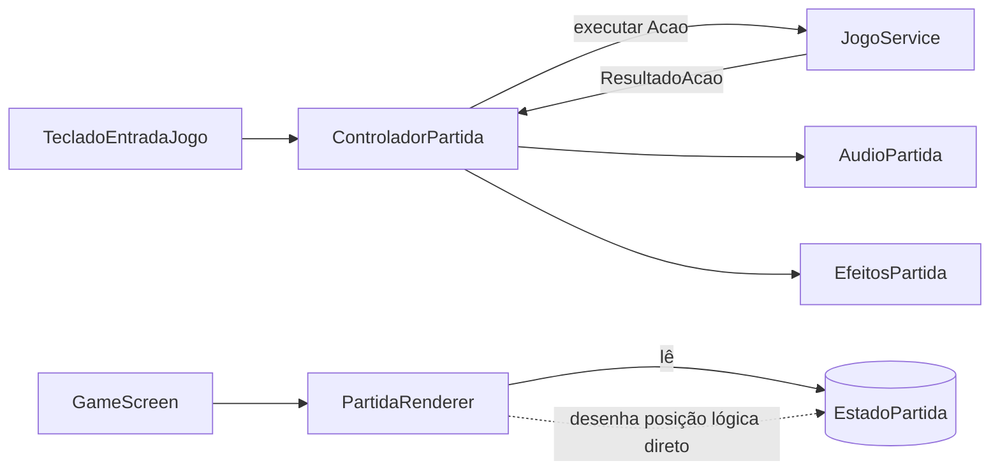
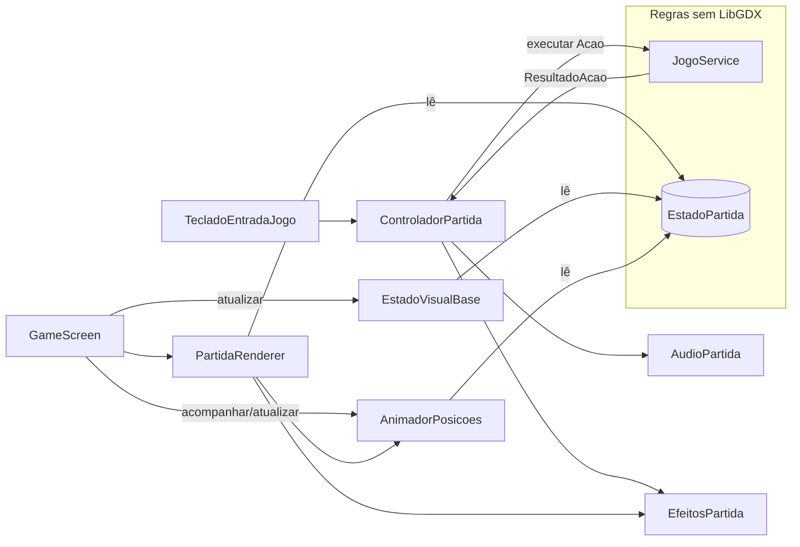
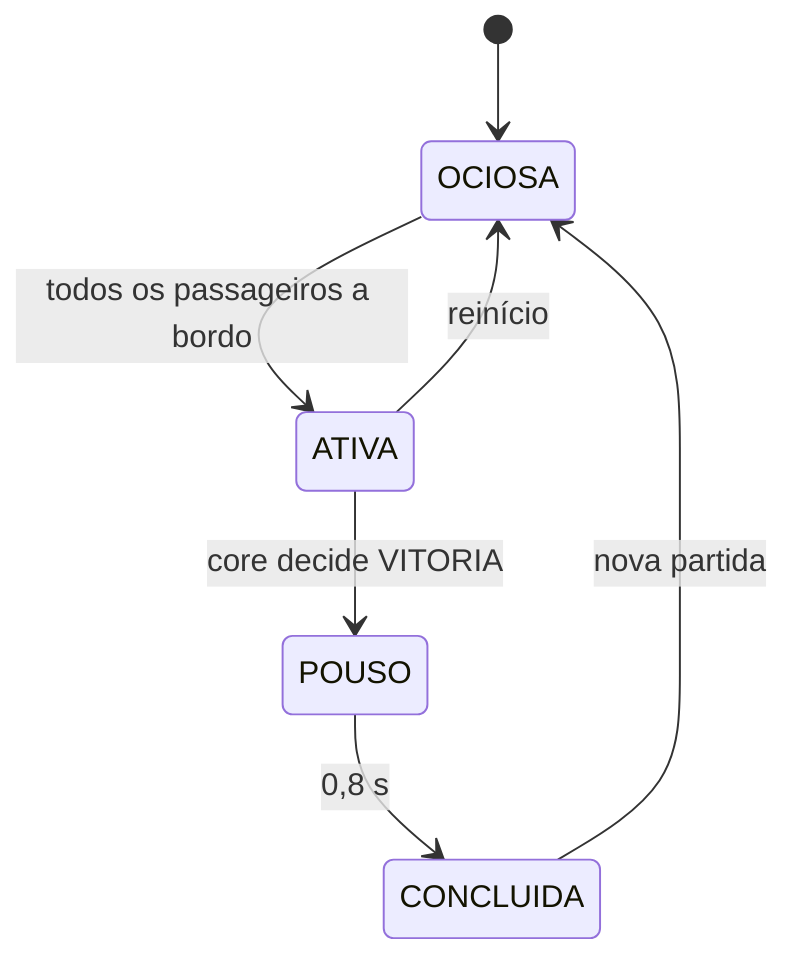

# Fase 4 — Interface gráfica: sprites, animação e movimento visual

## 1. Introdução

A Fase 3 colocou o Missão Marte dentro do ciclo de vida LibGDX (`Game`, `Screen`,
`render`) e já desenhava sprites, tocava sons e mostrava um HUD. A Fase 4
transforma essa apresentação num jogo gráfico completo: sprites e texturas do
pacote SpaceRage, **movimento visual** entre células, **animações por quadros**,
**feedback de colisão**, HUD e telas redesenhados e fundo em tela cheia.

A restrição central da fase: **preservar as regras de negócio**. O jogo continua
por turnos — uma tecla, um turno — e nenhum arquivo de `model`, `service` ou
`repository` foi alterado. Tudo o que mudou está em `core/presentation`,
`core/screen` e no smoke gráfico.

Plano aprovado: [`docs/plano-fase-04.md`](../../../docs/plano-fase-04.md).

## 2. Objetivos de aprendizagem

- Organizar texturas no `AssetManager` e reutilizar `TextureRegion`s sem criar objetos por frame.
- Montar animações por quadros com `Animation<TextureRegion>` e seus `PlayMode`s.
- Separar **posição lógica** (inteira, decidida pelas regras) de **posição visual** (interpolada).
- Modelar estados visuais com o padrão **State** sem tocar nas regras.
- Diferenciar colisão de **regra** (grade discreta) de colisão **geométrica** (`Intersector`).
- Usar nine-slice (`NinePatch`) e `ExtendViewport` para interfaces que se adaptam à janela.
- Testar animação sem OpenGL e validar a renderização com janela real.

## 3. Conceitos teóricos

Referencial: [`tutorial-api-gradle-libgdx.md`](../../../tutorial-api-gradle-libgdx.md),
consultado pelos títulos (a numeração interna se repete):

| Tema | Seção do referencial | Como foi usado aqui |
|---|---|---|
| Sprites e texturas | Parte 3 — “Sprites e Texturas” | Pipeline PNG → `Texture` (GPU) → região desenhada pelo `SpriteBatch`; carga única |
| Sons | Parte 3 — “Sons e Áudio” | `Sound` para efeitos curtos, `Music` (streaming) para trilha e Game Over — mantidos da Fase 3 |
| HUD | Parte 3 — “HUD (Head-Up Display)” | HUD em Scene2D (`Stage`/`Table`/`Label`), desenhado depois do mundo |
| Colisões | Parte 3 — “Detecção de Colisões” e “Efeito visual de explosão” | Comparação grade × hitbox; explosão por quadros |
| Exemplos | Parte 6 — `Nave`, `Asteroide`, `GameScreen` | Somente como referência de estrutura; as classes do Exercício 10 foram mantidas |
| Sem imagens | Parte 7 — `ShapeRenderer` | Alternativa citada; não necessária pois há sprites |
| Controles | Parte 9 — “Controles do Jogo” | Controles reais do projeto (WASD, C, Q, R, P, ESC) |

O referencial **não cobre** animação por quadros, interpolação nem viewports;
complementamos com a documentação oficial:

- Animação 2D: <https://libgdx.com/wiki/graphics/2d/2d-animation>
- Interpolação: <https://libgdx.com/wiki/math-utils/interpolation>
- Viewports: <https://libgdx.com/wiki/graphics/viewports>

**Animação por quadros.** `Animation<TextureRegion>` guarda uma lista de quadros e
a duração de cada um. `getKeyFrame(tempo)` devolve o quadro certo para um tempo
acumulado. `PlayMode.NORMAL` toca uma vez (explosão), `LOOP` repete (propulsor) e
`LOOP_PINGPONG` vai e volta (astronauta respirando).

**Interpolação.** Dados origem `a`, destino `b` e progresso `t ∈ [0,1]`, a posição
é `a + (b - a) · f(t)`. `Interpolation.smooth` é uma curva que acelera e desacelera,
dando um deslize mais natural que o linear.

**Colisão discreta × contínua.** O referencial usa jogo contínuo: objetos andam
`velocidade · delta` e colidem quando círculos/retângulos se sobrepõem
(`Intersector.overlaps`). No Missão Marte, as entidades ocupam **células inteiras**
e colidem quando estão na mesma célula — isso é regra de negócio, decidida no
`JogoService`. Usar hitboxes de pixels mudaria a regra (o tamanho do sprite
passaria a decidir uma colisão). Por isso a apresentação só **reage** ao evento
`COLISAO`/`NAVE_DESTRUIDA`.

**Viewport.** `FitViewport` mantém proporção fixa e adiciona faixas pretas;
`ExtendViewport` mantém um tamanho mínimo (1280×800) e **amplia** o mundo no eixo
que sobra, sem distorcer nem criar faixas.

## 4. Problemas encontrados no código original (Fase 3)

1. **Teletransporte**: a nave saltava de uma célula a outra num único frame.
2. **Objetos criados por frame**: `new TextureRegion(...)` para cada asteroide,
   inimigo e nave em todo `render()` — lixo para o coletor a 60 fps.
3. **Base sem sprite**: um quadrado translúcido com o texto “BASE”.
4. **Passageiro estático** e efeito de resgate sem animação.
5. **Colisão pouco perceptível**: só a explosão; a nave não indicava o dano.
6. **Faixas laterais**: `FitViewport` + fundo desenhado só na área central.
7. **Assets SpaceRage** (HUD, rodapé, painéis, botões, base, astronautas) prontos e não usados.
8. **SPACE/“TIRO”** exibido no rodapé sem existir a mecânica.

## 5. Arquitetura antes da transformação



`PartidaRenderer` convertia a posição inteira da nave diretamente em pixels.

## 6. Passo a passo da implementação

### 6.1. Cópia independente

Copiamos os arquivos versionados de `fase-03-libgdx` (sem `build/`, `.gradle/`,
rankings ou a pasta `docs/`) para `fase-04-interface-grafica` e renomeamos o
projeto em `settings.gradle` (`missao-marte-fase-04`). Versões mantidas:
Java 17, Gradle 8.7 (Groovy), LibGDX/FreeType 1.12.1, JUnit 5.10.2.

### 6.2. Registrar as texturas uma vez (`RecursosJogo`)

Novos caminhos (`HUD_SUPERIOR`, `RODAPE`, `PAINEL_MENU`, `BASE_*`, `ASTEROIDES[]`,
`astronauta(i)`, `resgate(i)`) entram no mesmo `AssetManager`. As sprites de pixel
art recebem filtro `Nearest` para não borrar ao ampliar. Molduras viram
`NinePatchDrawable` por `moldura(caminho, esquerda, direita, cima, baixo)`.

### 6.3. Pré-criar regiões e animações (`PartidaRenderer`)

O construtor monta todas as `TextureRegion`s e quatro animações (explosão,
propulsor, astronauta, resgate). `desenhar()` só consulta e desenha.

### 6.4. Movimento visual (`AnimadorPosicoes`)

A cada frame a tela chama `acompanhar(estado)`: se a célula da nave (ou de um
inimigo) mudou, inicia um trajeto de 0,15 s a partir da **posição desenhada no
momento** — assim uma tecla rápida “corta” a animação sem salto. `atualizar(delta)`
avança o tempo; o renderer lê `naveX()/naveY()` em vez de `nave().x()`.

### 6.5. Estado visual da base (`EstadoVisualBase`)

Quatro fases: `OCIOSA` → `ATIVA` (todos a bordo) → `POUSO` (0,8 s após a vitória)
→ `CONCLUIDA`. A classe **lê** `EstadoPartida.situacao()`; a vitória e o ranking já
foram decididos pelo core antes de o pouso começar.

### 6.6. Feedback de colisão

`EfeitosPartida` já criava uma `EXPLOSAO` por evento de colisão. O renderer usa a
idade dessa explosão para, durante 0,6 s, **piscar a nave** e aplicar um
**tremor decrescente** no desenho da área. Nenhum dado de regra é tocado.

### 6.7. HUD, rodapé, menu e pausa

`HudPartida` usa um painel superior contínuo (pontos, dificuldade, movimentos,
tempo) e um inferior (vidas com ícones da nave, passageiros com ícone de
astronauta). Os valores continuam vindo de `HudDados.de(estado)`. Botões usam
`menu_button_normal/hover/pressed`; menu e pausa usam `menu_panel`/`pause_panel`.
O rodapé mostra só controles existentes (SPACE removido).

### 6.8. Fundo em tela cheia

`GameScreen` e `MenuScreen` trocam `FitViewport` por `ExtendViewport` e desenham o
fundo num ator que cobre `getWorldWidth() × getWorldHeight()`, com recorte
proporcional (`PartidaRenderer.fundo`).

### 6.9. Testes e smoke

`AnimacaoVisualTest` (JUnit, sem OpenGL) cobre interpolação, corte da animação e
estados da base. `VerificacaoDesktop` ganhou capturas em 1366×768, 1600×900 e
1920×1080 e passou a gravar as capturas opacas.

## 7. Código antes e depois

**Posição da nave** — antes (Fase 3), posição lógica direto na tela:

```java
float nx = origemX + estado.nave().x() * passoX;
float ny = origemY + estado.nave().y() * passoY;
```

Depois (Fase 4), posição visual interpolada:

```java
float nx = origemX + posicoes.naveX() * passoX;
float ny = origemY + posicoes.naveY() * passoY;
```

```java
// AnimadorPosicoes.Trajeto
void destino(int x, int y) {
    if (x == destinoX && y == destinoY) return;
    origemX = x();          // parte de onde está desenhado agora
    origemY = y();
    destinoX = x; destinoY = y;
    tempo = 0;
}
float x() { return origemX + (destinoX - origemX) * Interpolation.smooth.apply(tempo / DURACAO); }
```

**Asteroides** — antes, uma região nova por asteroide em cada frame:

```java
desenharImagem(batch, new TextureRegion(recursos.textura(RecursosJogo.ASTEROIDE)), ...);
```

Depois, regiões criadas no construtor e variação só visual pela posição:

```java
int variacao = Math.floorMod(a.x() * 31 + a.y() * 17, asteroides.length);
desenharImagem(batch, asteroides[variacao], ..., tamanho * ESCALA_ASTEROIDE[variacao]);
```

**Animação por quadros** do astronauta:

```java
astronauta = animacao(recursos, 4, 0.18f, Animation.PlayMode.LOOP_PINGPONG, RecursosJogo::astronauta);
...
astronauta.getKeyFrame(tempoVisual + (p.x() + p.y()) * 0.13f) // fase deslocada por posição
```

**Base** — antes: quadrado + texto `"BASE"`. Depois:

```java
faseBase = base.atualizar(controlador.estado(), delta);   // GameScreen
desenharImagem(batch, base[fase.ordinal()], origemX, origemY, tamanho * 1.45f); // renderer
```

**Viewport** — antes `new FitViewport(1280, 800)`; depois `new ExtendViewport(1280, 800)`.

## 8. Explicação das alterações

| Decisão | Motivo |
|---|---|
| Movimento interpolado só na apresentação | O enunciado pede movimentação, mas as regras são por turno. Animar o desenho entrega a sensação de movimento sem mudar pontuação, colisões ou contagem de movimentos |
| Animador como novo consumidor do estado | Mantém o fluxo da Fase 3 (Observer leve: áudio, efeitos e animação reagem ao resultado); `JogoService` não sabe que existe animação |
| `EstadoVisualBase` separado | Padrão **State** e GRASP **Pure Fabrication**: lógica testável sem OpenGL e sem poluir a `Nave` ou a `Missao` |
| Colisão continua por célula | É regra de negócio. Hitbox geométrica mudaria quando o jogador perde vida (OCP: estendemos a reação visual, não a regra) |
| Regiões e animações pré-criadas | Evita alocação por frame; `render` só desenha (referencial: “Sprites e Texturas”) |
| `Nearest` nas sprites | Pixel art ampliado com `Linear` fica borrado |
| Nine-slice nos painéis | Cantos e bordas mantêm espessura em qualquer largura |
| `ExtendViewport` | Remove faixas pretas sem distorcer a imagem |
| Sem SPACE no rodapé | Não exibir controles inexistentes; tiro fica para a Fase 7 |
| Sons inalterados | `AudioPartida` já cobria impacto, resgate, vitória, derrota e menu |

## 9. Arquitetura resultante





Dependências: `lwjgl3 → core → gdx`. Pacotes `model`, `service` e `repository`
continuam sem imports LibGDX.

## 10. Como executar e testar

Com JDK 17 (nesta máquina Windows: `~/.jdks/openjdk-17.0.2`), dentro de
`fases/fase-04-interface-grafica/`:

```bash
export JAVA_HOME=~/.jdks/openjdk-17.0.2
./gradlew clean build            # compila e roda 48 casos JUnit
./gradlew :lwjgl3:run            # jogo gráfico
./gradlew :lwjgl3:smokeDesktop   # janela real, 12 capturas em lwjgl3/build/reports/smoke/
./gradlew :lwjgl3:runConsole --console=plain
./gradlew :lwjgl3:installDist    # distribuição em lwjgl3/build/install/lwjgl3/
```

O que conferir manualmente: a nave desliza ao apertar WASD; teclas rápidas não
pulam animação; colidir com um asteroide faz a nave piscar e a tela tremer;
embarcar (C) mostra o astronauta subindo; com todos a bordo a base acende; ao
pousar em (0,0) a vitória aparece imediatamente e a plataforma passa a
“concluída”. Redimensione a janela: não devem surgir faixas pretas.

## 11. Exercícios para os alunos

1. Troque `Interpolation.smooth` por `Interpolation.swingOut` e por `linear`. Qual
   comunica melhor um movimento por turno? Por quê?
2. Faça os inimigos girarem para a direção do último movimento (dica:
   `batch.draw` com rotação). Onde essa direção deve ser calculada — no core ou na
   apresentação?
3. Implemente um modo de depuração com `ShapeRenderer` (Parte 7 do referencial)
   que desenhe a grade lógica e o retângulo de cada célula.
4. Adicione um som curto quando a base passa para `ATIVA`, sem alterar `JogoService`.
5. Proponha (sem implementar) como seria a colisão se o jogo fosse contínuo. Que
   classes de regra precisariam mudar? Compare com o exemplo da Parte 6.
6. Escreva um teste que garanta que `EstadoVisualBase` nunca devolve `POUSO` para
   uma partida `DERROTA`.

## 12. Conclusão

A apresentação ficou animada e coerente com o pacote SpaceRage sem que nenhuma
regra mudasse: as 162 verificações herdadas continuam passando. A chave foi
separar **o que aconteceu** (estado e eventos do core) de **como mostrar** (animador,
estado visual, efeitos e renderer). Essa mesma separação vai permitir, na Fase 5,
enviar o resultado ao servidor e, na Fase 6, trocar teclado por toque sem tocar
nas regras.
