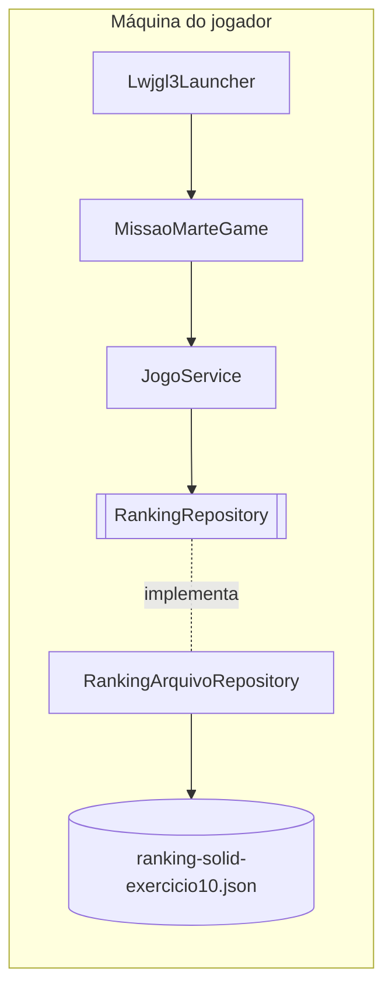
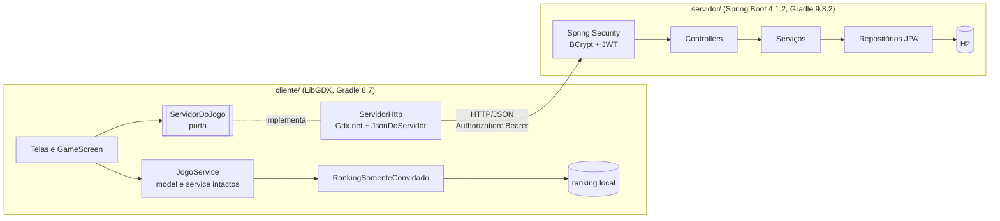
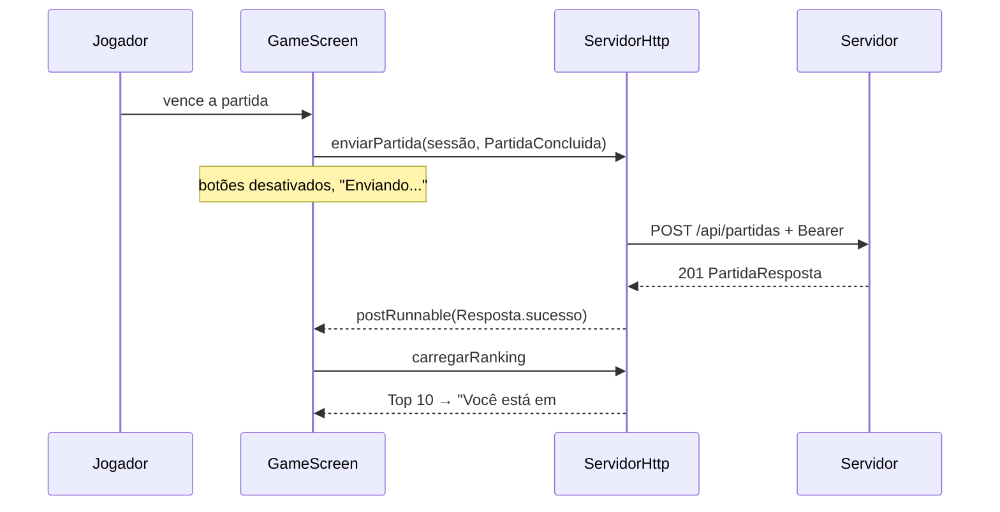
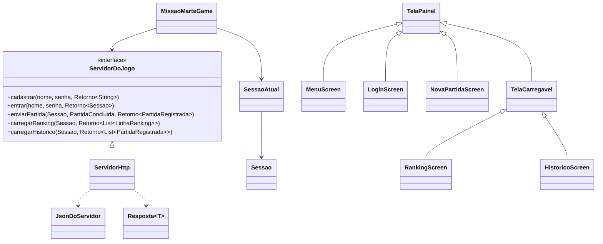
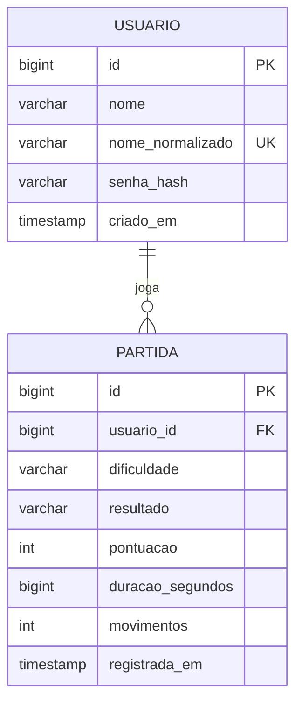

# Fase 5 — Servidor e ranking global

## 1. Introdução

Até a Fase 4, o ranking do Missão Marte era um arquivo JSON na máquina do
jogador. Qualquer um podia editá-lo, cada computador tinha o seu e não existia
o conceito de usuário. Esta fase cria um **servidor independente em Spring
Boot**, com cadastro, login, histórico de partidas e um **ranking global
(Top 10)**. O cliente LibGDX passa a consumir esse servidor por uma **API REST**.

Seguimos o enunciado do professor (`fase-05-enunciado.md`), que mantém um
**modo convidado**: dá para jogar sem login, usando o ranking local. Quem
entra na conta usa o ranking global. Isso diverge do "login obrigatório" do
prompt mestre; a escolha está registrada no
[plano aprovado](../../../docs/plano-fase-05.md#9-divergências-registradas).

Regra central: **o servidor não executa a lógica do jogo.** Ele recebe o
resultado pronto. `model` e `service` do cliente são **idênticos** aos da Fase 4
(conferido por hash, seção 10).

## 2. Objetivos de aprendizagem

- Explicar o que é uma API REST, os métodos HTTP e os códigos 200, 201, 400, 401 e 409.
- Montar um servidor em camadas (controller → serviço → repositório) com Spring Boot e JPA.
- Guardar senhas com hash, sal e custo (BCrypt) e explicar por que não se criptografa senha.
- Autenticar com JWT numa API sem estado e proteger rotas "por padrão".
- Validar entradas e responder erros no formato `ProblemDetail` (RFC 9457).
- Chamar a API pelo LibGDX sem travar o desenho (`Gdx.net` + `postRunnable`).
- Isolar a rede atrás de uma porta (Port and Adapter) e testar o JSON sem janela.
- Reconhecer o que um servidor que não executa o jogo **não** consegue garantir.

## 3. Conceitos teóricos

O `tutorial-api-gradle-libgdx.md` não cobre servidor, JPA nem autenticação.
Usamos a documentação oficial:

- Spring Boot: <https://docs.spring.io/spring-boot/reference/> (e o guia de migração 4.0).
- Spring Security, armazenamento de senhas: <https://docs.spring.io/spring-security/reference/features/authentication/password-storage.html>
- Spring Security, OAuth2 Resource Server e JWT: <https://docs.spring.io/spring-security/reference/servlet/oauth2/resource-server/jwt.html>
- Spring Data JPA: <https://docs.spring.io/spring-data/jpa/reference/>
- RFC 9457, Problem Details: <https://www.rfc-editor.org/rfc/rfc9457>
- OWASP Password Storage Cheat Sheet: <https://cheatsheetseries.owasp.org/cheatsheets/Password_Storage_Cheat_Sheet.html>
- libGDX Networking: <https://libgdx.com/wiki/networking>

**API REST.** O cliente manipula **recursos** (usuários, partidas, ranking) por
URLs e métodos HTTP: `POST` cria e `GET` consulta. O código de status resume o
resultado:

| Código | Significado | Exemplo nosso |
|---|---|---|
| 200 | OK | `POST /api/auth/login` correto |
| 201 | Criado | `POST /api/usuarios`, `POST /api/partidas` |
| 400 | Requisição inválida | nome com 2 letras, pontuação fora da faixa, enum desconhecido |
| 401 | Não autenticado | sem token, token adulterado ou expirado, senha errada |
| 409 | Conflito | nome já existente (`Ana` × `ana`) |

**Camadas e DTO.**
- O controller traduz HTTP, o serviço aplica a regra e o repositório persiste.
- **DTO** (*Data Transfer Object*) é o formato que viaja na rede. Usamos
  `record`s (`CadastroRequisicao`, `PartidaResposta`…), e as entidades JPA nunca
  saem pela API. Assim o hash da senha não vaza por engano.

**JPA.**
- O Hibernate mapeia classes (`@Entity`) para tabelas.
- O Spring Data gera os repositórios: `findByNomeNormalizado` vira um `SELECT`
  automaticamente.
- O ranking usa uma consulta JPQL com **subconsulta** (`not exists`): uma
  vitória entra se **nenhuma outra vitória do mesmo jogador for melhor**, com
  desempate por pontos, menor tempo, mais antiga e menor id.

**Hash, sal e custo.**
- Hash é uma função de mão única: o servidor guarda `BCrypt(senha)` e, no
  login, recalcula e compara. Criptografia seria reversível: quem roubasse a
  chave leria todas as senhas.
- O **sal** aleatório faz duas senhas iguais terem hashes diferentes (há teste
  disso).
- O **custo** (10 = 2¹⁰ rodadas) torna cada tentativa lenta para quem ataca o
  banco vazado.
- O BCrypt só lê **72 bytes**, por isso o cadastro rejeita senhas maiores em
  vez de cortá-las em silêncio.
- A OWASP recomenda **Argon2id** para sistemas novos, porque ele também gasta
  memória, o que encarece ataques com GPU. Mantivemos BCrypt pela simplicidade
  e por ser o padrão do Spring.

**JWT e "sem estado".**
- O login devolve um token `cabeçalho.dados.assinatura` (HS256). Os dados
  incluem `sub` (id do usuário), `nome`, `iat` e `exp` (2 h), e **nunca a senha**.
- A cada requisição, o servidor valida assinatura e validade sem consultar
  sessão alguma: a API é **sem estado**.
- Se o token vazar, quem o tiver age como o usuário até expirar. Não há
  revogação nesta fase.

**Validar de novo no servidor.** O cliente valida para avisar cedo, mas
qualquer um pode chamar a API com `curl`. Só a validação do servidor é confiável.

**Rede assíncrona no LibGDX.**
- `Gdx.net.sendHttpRequest` não bloqueia: a linha seguinte roda antes da
  resposta.
- O *listener* é chamado em outra thread, e a tela só pode ser alterada na
  thread de desenho. Por isso todo resultado passa por `Gdx.app.postRunnable`.

**Port and Adapter.**
- A **porta** é a interface `ServidorDoJogo`: o que o jogo precisa, sem saber
  que é HTTP.
- O **adaptador** é o `ServidorHttp`, que fala HTTP com `Gdx.net`.
- Trocar por outro transporte, ou por um falso nos testes, não muda as telas.

## 4. Problemas encontrados no código original (Fase 4)

1. Ranking num arquivo local: editável, por máquina e sem dono.
2. Sem usuários: todos jogavam como "Piloto Anônimo".
3. Só a vitória era registrada (`JogoService` chama `ranking.salvar` apenas na
   vitória). Derrotas não existiam em lugar nenhum, logo não havia histórico.
4. A dificuldade estava fixa em MÉDIO na janela, sem tela de nova partida.
5. O ranking só aparecia no console; a interface gráfica não tinha tela de ranking.

## 5. Arquitetura antes da transformação



## 6. Passo a passo da implementação

| # | Passo | Comando ou arquivo |
|---|---|---|
| 1 | Branch e cópia da Fase 4 para `cliente/` (sem `build`, `.gradle`, `.idea`, ranking) | `git checkout -b fase-05-servidor-ranking` |
| 2 | Wrapper do servidor: o Gradle 8.7 gera o wrapper 9.8.2, que se regenera com o SHA-256 oficial | `../cliente/gradlew -p . wrapper --gradle-version 9.8.2 --gradle-distribution-sha256-sum <sha>` |
| 3 | `build.gradle` com Spring Boot 4.1.2 e os starters novos (`webmvc`, `data-jpa`, `security`, `security-oauth2-resource-server`, `validation`) | `servidor/build.gradle` |
| 4 | Entidades `Usuario` (índice único em `nome_normalizado`) e `Partida` | `usuario/`, `partida/` |
| 5 | Segurança: BCrypt(10), `JwtEncoder`/`JwtDecoder` HS256 com a mesma chave, tudo protegido por padrão | `seguranca/SegurancaConfig.java` |
| 6 | Controllers, serviços, DTOs e `TratadorDeErros` (`ProblemDetail`) | `*Controller`, `erro/` |
| 7 | Consulta do ranking com subconsulta | `PartidaRepository.melhoresVitorias` |
| 8 | 27 testes MockMvc + `requests.http` + Swagger | `src/test`, `requests.http` |
| 9 | Cliente: porta `remoto/ServidorDoJogo` e tipos sem LibGDX | `core/.../remoto/` |
| 10 | Adaptador `ServidorHttp` (`Gdx.net`) e conversor `JsonDoServidor` | `presentation/rede/` |
| 11 | Telas: `LoginScreen`, `NovaPartidaScreen`, `RankingScreen`, `HistoricoScreen`; menu em dois modos | `screen/` |
| 12 | Envio no fim da partida (`GameScreen`) e decorador `RankingSomenteConvidado` | `GameScreen`, `repository/` |
| 13 | Launcher monta `ServidorHttp(-Dmissaomarte.servidor)` e a sessão | `Lwjgl3Launcher` |
| 14 | Testes do cliente (22 novos) e smoke ponta a ponta contra o servidor real | `VerificacaoOnline` |

**Problemas reais e como foram resolvidos**

- **O Boot 4 não roda no Gradle 8.7 do cliente.** Ele exige 8.14+ ou 9.x. Em vez
  de mexer no cliente, o servidor ganhou seu próprio wrapper 9.8.2 (dois builds
  independentes).
- **O resource server espera RS256.** Com segredo simétrico, foi preciso
  declarar `NimbusJwtDecoder.withSecretKey(chave).macAlgorithm(HS256)` e o
  `NimbusJwtEncoder` com a mesma chave.
- **Token expirado ainda aceito.** O validador padrão tolera 60 s de diferença
  de relógio, então o teste gera um token vencido há 1 hora.
- **Tecla R com dois sentidos.** Na Fase 4, R reinicia a partida encerrada; o
  enunciado pede R para reenviar após falha. Enquanto o envio está pendente ou
  falhou, a `GameScreen` lê a tecla ela mesma e R reenvia. Só depois do envio R
  volta a reiniciar, para que o resultado não se perca.
- **Botão invisível ocupando espaço.** Num `Table` do Scene2D, um ator invisível
  continua com sua célula. A linha de botões do resultado passou a ser
  reconstruída só com os visíveis.
- **Dica da tela de login transbordando.** O smoke com capturas mostrou o
  problema; o painel passou de 760 para 900.
- **`bootRun` continuou ouvindo a porta 8080 depois de parar o terminal.** O
  processo Java filho do Gradle sobreviveu e foi encerrado pelo PID que aparece
  no log. Dois servidores no mesmo arquivo H2 travariam um ao outro.
- **Cópia inicial no diretório errado.** `git ls-files` listou caminhos
  relativos a outra pasta. A pasta incompleta foi apagada e a cópia refeita de
  dentro da Fase 4.

## 7. Código antes e depois

**Composição no launcher.** Antes:

```java
var ranking = new RankingArquivoRepository("ranking-solid-exercicio10.json");
var jogo = new JogoService(ranking, new FabricaMissoes(), new Random(), relogio);
new Lwjgl3Application(new MissaoMarteGame(jogo, new TecladoEntradaJogo(), relogio), configuracao);
```

Depois:

```java
var sessao = new SessaoAtual();
// Convidado grava a vitória no arquivo local; logado, o resultado vai para o servidor.
var ranking = new RankingSomenteConvidado(new RankingArquivoRepository("ranking-solid-exercicio10.json"),
        () -> !sessao.logado());
var jogo = new JogoService(ranking, new FabricaMissoes(), new Random(), relogio);
var servidor = new ServidorHttp(System.getProperty("missaomarte.servidor", SERVIDOR_PADRAO));
new Lwjgl3Application(new MissaoMarteGame(jogo, new TecladoEntradaJogo(), relogio, servidor, sessao), configuracao);
```

**JSON sem concatenação** (`JsonDoServidor`):

```java
public static String credenciais(String nome, String senha) {
    return escrever(w -> w.set("nome", nome).set("senha", senha)); // JsonWriter escapa aspas e barras
}
```

**Resultado sempre na thread de desenho** (`ServidorHttp`):

```java
@Override public void handleHttpResponse(Net.HttpResponse resposta) {
    entregar(retorno, interpretar(resposta.getStatus().getStatusCode(), resposta.getResultAsString(),
            sessao != null, conversor));
}
private static <T> void entregar(Retorno<T> retorno, Resposta<T> resposta) {
    Gdx.app.postRunnable(() -> retorno.receber(resposta));
}
```

**Dono da partida vem do token** (`PartidaController`):

```java
public PartidaResposta registrar(@AuthenticationPrincipal Jwt token, @Valid @RequestBody PartidaRequisicao requisicao) {
    return servico.registrar(Long.valueOf(token.getSubject()), requisicao);
}
```

**Login sem revelar quem existe** (`AutenticacaoService`):

```java
if (usuario.isEmpty()) {
    senhas.matches(requisicao.senha(), hashFalso); // mesmo custo de tempo
    throw new CredenciaisInvalidasException();     // mesma mensagem da senha errada
}
```

## 8. Explicação das alterações

### 8.1 Estado de origem e destino

| Fase 4 | Fase 5 |
|---|---|
| `ranking-solid-exercicio10.json` | Convidado: continua igual. Logado: banco H2 do servidor |
| "Piloto Anônimo" | Convidado digita o nome; logado usa o nome da conta |
| Dificuldade fixa MÉDIO | Tela de nova partida com FÁCIL, MÉDIO e DIFÍCIL |
| Só a vitória registrada | Vitória e derrota vão para o histórico; o aborto não é enviado |
| Ranking síncrono, só no console | Ranking local síncrono (convidado) ou global assíncrono (logado) |
| Sem usuários | Cadastro, login com JWT e sessão em memória |



Regra de dependência: `model`, `service`, `repository` e `remoto` não importam
`com.badlogic`. O servidor não depende do cliente: tem sua própria cópia do enum
`Dificuldade`, e o contrato é JSON.



### 8.2 Conceitos aplicados

Estão na seção 3, com exemplos do código na seção 7.

### 8.3 Segurança: o que foi tratado e o que não foi

| Ameaça | Tratamento |
|---|---|
| Banco vazado | Só o hash BCrypt (custo 10, sal por conta); testes conferem o hash e o sal |
| Enumeração de usuários | Mesma mensagem e mesmo custo de tempo (hash falso) para usuário inexistente e para senha errada |
| Token falsificado ou expirado | Assinatura HS256 e `exp` validados; testes com token adulterado e vencido dão 401 |
| Gravar em nome de outro | Dono vem do `sub` do token; campo `usuario` no corpo é ignorado (teste) |
| JSON malicioso | Servidor: JSON inválido ou enum desconhecido viram 400 genérico. Cliente: `JsonWriter` escapa aspas e barras (teste com `a"b\c`) |
| Senha em log ou tela | `toString` dos DTOs, do formulário e da sessão esconde senha e token; o log do servidor foi conferido |
| Exposição na rede | O servidor escuta só em `127.0.0.1` |
| Segredo no repositório | `MISSAOMARTE_JWT_SEGREDO` vem do ambiente; sem ele, o servidor gera um aleatório e avisa no log |

**O que não foi tratado:**
- **Pontuação falsificada.** Como o servidor não executa o jogo, um cliente
  modificado pode enviar 100 000 pontos dentro da faixa aceita. A defesa real
  exigiria o servidor reproduzir a partida (por exemplo, recebendo a semente e
  a lista de ações e recalculando).
- **HTTPS.** Tudo trafega em texto claro; use só em `localhost` ou rede de
  confiança.
- **Força bruta no login.** Não há limite de tentativas.
- **Renovação e revogação de token.**
- **Fila de reenvio offline.** Se o envio falhar e o jogador sair da tela, a
  partida não é gravada.

**Por que o segredo vem do ambiente:** quem conhece o segredo HS256 consegue
emitir tokens válidos para qualquer usuário. Se ele estivesse no código, estaria
no Git.

### 8.4 Decisões de projeto

- **Dois builds independentes.** O Spring Boot 4.1 exige Gradle 8.14+ e o
  cliente segue no 8.7 desde a Fase 2. Além disso, o servidor não deve depender
  do código do jogo, e builds separados tornam isso impossível de violar por
  acidente.
- **Cópia do enum `Dificuldade` no servidor.** O contrato é o texto JSON
  (`"MEDIO"`), não a classe Java. Compartilhar a classe acoplaria os dois
  lançamentos.
- **Modo convidado.** É decisão de produto do enunciado. O custo foi um menu com
  dois modos, o decorador do ranking local e o cuidado de nunca enviar a
  partida do convidado.

**Padrões e onde estão:**
- **De fato:** Repository (Spring Data), DTO (records), Port and Adapter
  (`ServidorDoJogo`/`ServidorHttp`), Callback (`Retorno`), Decorator
  (`RankingSomenteConvidado`), Template Method (`TelaPainel`/`TelaCarregavel`,
  que delegam `buscar()` às subclasses) e injeção de dependência (Spring e o
  launcher).
- **Parece, mas é mais simples:** os "estados" de `TelaCarregavel` e do envio
  são um `enum` com `switch`, sem uma classe por estado, ou seja, não são o
  padrão State completo. `SessaoAtual` é um objeto compartilhado montado pelo
  launcher, não um Singleton.

## 9. Arquitetura resultante





**Arquivos novos ou alterados no cliente** (todo o resto é idêntico à Fase 4):

| Arquivo | Por quê |
|---|---|
| `remoto/*` (novo) | Porta e tipos de apoio, sem LibGDX |
| `repository/RankingSomenteConvidado` (novo) | Ranking local só no modo convidado |
| `presentation/rede/*` (novo) | Adaptador HTTP e conversão de JSON |
| `presentation/FormularioLogin` (novo) | Regras do formulário, testáveis |
| `presentation/HudDados` | Formatação de dificuldade e tempo reaproveitada pelas tabelas |
| `screen/TelaPainel`, `TelaCarregavel`, `LoginScreen`, `NovaPartidaScreen`, `RankingScreen`, `HistoricoScreen` (novos) | Telas da fase |
| `screen/MenuScreen` | Menu em dois modos |
| `screen/GameScreen` | Envio único no fim da partida, estados e R para reenviar |
| `MissaoMarteGame` | Navegação, sessão e servidor injetados |
| `lwjgl3/Lwjgl3Launcher`, `lwjgl3/build.gradle` | Composição, `-Dmissaomarte.servidor` e tarefa `smokeOnline` |

## 10. Como executar e testar

Dois terminais, com JDK 17 primeiro no `PATH`.

```bash
# Terminal 1 - servidor
cd servidor
./gradlew --version            # Gradle 9.8.2, JVM 17
./gradlew test                 # 27 testes
./gradlew bootRun --console=plain
```

```bash
# Terminal 2 - cliente
cd cliente
./gradlew --version            # Gradle 8.7, JVM 17
./gradlew clean build          # 70 testes
./gradlew :lwjgl3:run --console=plain
./gradlew :lwjgl3:run -Dmissaomarte.servidor=http://localhost:8080 --console=plain
./gradlew :lwjgl3:smokeDesktop   # janela, modo convidado, sem servidor
./gradlew :lwjgl3:smokeOnline    # janela contra o servidor no ar; gera as capturas
```

### Evidências (22/11/2026, Windows 11, OpenJDK 17.0.2)

**Testes:**
- **Servidor:** `./gradlew test` passou com **27 testes**: Usuario 7, Auth 7,
  Partida 6, Ranking 5, Documentação 2.
- **Cliente:** `./gradlew clean build` passou com **70 testes**: os 48 da Fase 4,
  incluindo as 162 verificações herdadas, e 22 novos: JSON 6, HTTP 5,
  formulário 4, dados do servidor 5 e histórico 2.
- **Isolamento:** nenhum teste JUnit abre janela, usa OpenGL ou rede. Os testes
  do servidor usam H2 em memória e um segredo fixo de teste.

**Ponta a ponta:**
- **`smokeDesktop`** passou: modo convidado, com as 12 capturas herdadas.
- **`smokeOnline`** passou em 82 passos contra o servidor real. Cadastrou dois
  jogadores, enviou vitória e derrota, carregou ranking e histórico, mostrou a
  senha errada, simulou servidor desligado no login e no envio, fez o reenvio
  com R, saiu da conta e jogou como convidado sem servidor (gravou só no local).
  Também verificou que cada jogador aparece uma vez e na ordem certa.

**API via `curl`** contra o servidor real:
- cadastro: 201
- nome repetido em outra caixa: 409
- nome curto: 400 com `erros[campo=nome]`
- senha errada: 401 "Usuário ou senha inválidos."
- login: 200 com `tipo: Bearer`
- ranking sem token: 401
- registro com `"usuario":"outro"`: 201, gravado no dono do token
- histórico: 200
- ranking: 200
- token adulterado: 401
- Swagger: 200

**Log, rede e camadas:**
- O log do servidor não contém nenhuma senha nem token (busca por
  `senha-segura`, `senha-errada` e `eyJhbGci`) e nenhum `ERROR`.
- O `netstat` mostrou o servidor ouvindo só em `127.0.0.1:8080`.
- O SHA-256 dos fontes de `model` e de `service` é **igual** ao da Fase 4.
- Nenhum arquivo de `model`, `service`, `repository` ou `remoto` importa
  `com.badlogic`.
- `git status` não mostra alterações em fases anteriores, `missao1`, `missao2`
  ou no referencial.

**Capturas** (`docs/evidencias/`):

| Captura | Arquivo |
|---|---|
| Menu convidado | [01](evidencias/01-menu-convidado.png) |
| Cadastro com senha mascarada | [02](evidencias/02-cadastro-senha-mascarada.png) |
| Menu logado | [03](evidencias/03-menu-logado.png) |
| Nova partida (logado) | [04](evidencias/04-nova-partida-logado.png) |
| Vitória enviada + posição no Top 10 | [05](evidencias/05-vitoria-enviada.png) |
| Ranking global | [06](evidencias/06-ranking-global.png) |
| Derrota enviada | [07](evidencias/07-derrota-enviada.png) |
| Histórico | [08](evidencias/08-historico.png) |
| Falha de envio (servidor caiu) | [09](evidencias/09-falha-envio.png) |
| Reenvio com R | [10](evidencias/10-reenvio-com-r.png) |
| Saiu da conta | [11](evidencias/11-saiu-da-conta.png) |
| Senha errada | [12](evidencias/12-senha-errada.png) |
| Servidor desligado no login | [13](evidencias/13-servidor-desligado.png) |
| Dois jogadores, uma linha cada | [14](evidencias/14-ranking-dois-jogadores.png) |

## 11. Exercícios para os alunos

1. Troque o BCrypt por Argon2id (`Argon2PasswordEncoder`). O que muda nos testes de hash?
2. Acrescente `GET /api/ranking?dificuldade=FACIL` e um teste de empates por dificuldade.
3. Implemente limite de tentativas de login (por exemplo, 5 por minuto por nome) e teste o 429.
4. Troque o H2 por PostgreSQL com Flyway. Por que `ddl-auto=update` não serve em produção?
5. Crie uma fila local de reenvio para partidas que falharam. Onde ela deve ficar para não importar LibGDX?
6. Proponha uma forma de o servidor **verificar** a pontuação: o que o cliente precisaria enviar?

## 12. Conclusão

O jogo ganhou contas, histórico e um ranking compartilhado sem que nenhuma
regra mudasse: `model` e `service` são byte a byte os da Fase 4.
- **No servidor:** camadas claras, senha com hash, token assinado e "tudo
  protegido por padrão".
- **No cliente:** a rede ficou atrás de uma porta, e o mesmo `Gdx.net` funciona
  no Android. Na Fase 6 só será preciso apontar o endereço do servidor para a
  máquina na rede (`10.0.2.2` no emulador), declarar a permissão `INTERNET` e
  tratar o HTTP em texto claro do Android.

**Próximos passos:**

| Ponto | Fase |
|---|---|
| HTTP em texto claro e permissão `INTERNET` no Android | 6 |
| Controles de toque nas telas de login e de nova partida (hoje usam teclado ou cliques) | 6 |
| Ranking por dificuldade e chefões com pontuação própria | 7 |
| Fila de reenvio offline e renovação de token | 7 |
