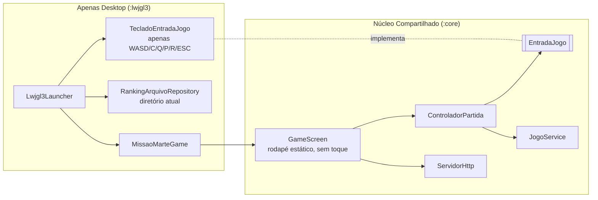
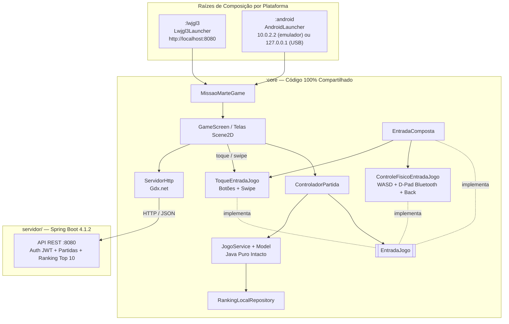
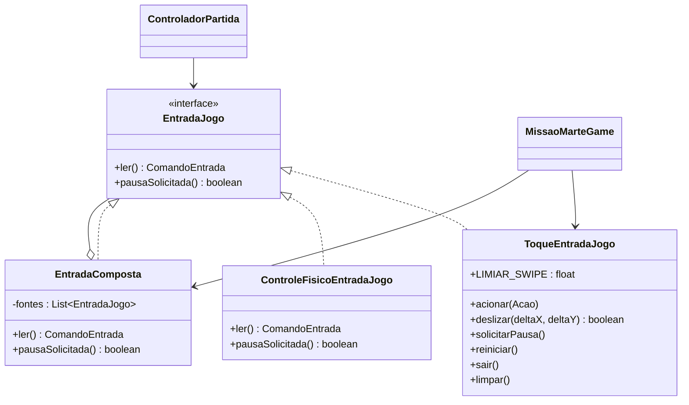

# Fase 6 — Adaptação Multiplataforma para Android

## 1. Introdução

Até a Fase 5, o cliente gráfico do **Missão Marte** executava exclusivamente no
desktop (via backend LWJGL3), embora já estivesse estruturado em um projeto
multi-módulo do LibGDX (`:core` e `:lwjgl3`) e conectado ao servidor Spring Boot
de ranking global.

Nesta **Fase 6**, levamos o mesmo jogo para o **Android**, mantendo o ecossistema
multiplataforma completo:

- **Versão Desktop (`:lwjgl3`) e Console (`:lwjgl3:runConsole`)** continuam funcionando integralmente.
- **Versão Android (`:android`)** reutiliza 100% do módulo `:core` (regras de negócio, animações, som, telas e cliente HTTP) e os mesmos arquivos de `core/assets`.
- **Controles por toque (touch e swipe)** foram incorporados na partida e nas telas de entrada de texto, permitindo jogar tanto em telas sensíveis ao toque quanto com mouse, teclado ou controle Bluetooth (D-Pad/gamepad).
- **Mesmo servidor de ranking global (Fase 5)** é consumido pela versão desktop e pela versão Android.

Regra central preservada: **os pacotes `model` e `service` permanecem intocados**
(mesmo hash SHA-256 desde a Fase 4), e nenhum arquivo de `model`, `service`,
`repository` ou `remoto` importa `com.badlogic`.

---

## 2. Objetivos de aprendizagem

- Compreender a arquitetura multiplataforma do LibGDX: um único núcleo (`:core`) e múltiplos *backends* (`:lwjgl3` para Desktop, `:android` para Android).
- Explicar o papel de uma **Raiz de Composição (*Composition Root*)** por plataforma (`Lwjgl3Launcher` vs. `AndroidLauncher`).
- Projetar controles por toque e gestos (*swipe*) discretos usando **Ports and Adapters** (`EntradaJogo` ← `ToqueEntradaJogo`) e o padrão **Composite** (`EntradaComposta`).
- Integrar suporte opcional a controles Bluetooth / D-Pad e tecla física *Voltar* (`Keys.BACK`) do Android sem acoplar as regras de negócio.
- Resolver as particularidades do sistema Android:
  - Ciclo de vida de `Activity` (`AndroidApplication`), orientação `sensorLandscape` e modo imersivo.
  - Extração de bibliotecas nativas (`.so`) por arquitetura (`armeabi-v7a`, `arm64-v8a`, `x86`, `x86_64`).
  - Armazenamento interno da aplicação (`Context.getFilesDir()`) para o ranking local do modo convidado.
  - Roteamento de rede no emulador Android (`10.0.2.2` para o `localhost` da máquina hospedeira), permissão `INTERNET` e política de tráfego HTTP em texto claro (*cleartext traffic*).

---

## 3. Conceitos teóricos

Como o referencial `tutorial-api-gradle-libgdx.md` cobre apenas as Fases 2, 3 e 4,
utilizamos a documentação oficial do LibGDX e do Android para esta fase:

- libGDX Project Setup & Modules: <https://libgdx.com/wiki/start/project-generation>
- libGDX Input Handling (Touch, Gestures, Soft Keyboard & Back Key): <https://libgdx.com/wiki/input/input-handling>
- Android Developers — Configure the Android Emulator Networking (`10.0.2.2`): <https://developer.android.com/studio/run/emulator-networking>
- Android Developers — Network Security Configuration (`cleartextTrafficPermitted`): <https://developer.android.com/privacy-and-security/security-config>
- Android Developers — App-specific storage (`getFilesDir()`): <https://developer.android.com/training/data-storage/app-specific>

### 3.1. Arquitetura Multiplataforma no LibGDX (`:core`, `:lwjgl3`, `:android`)

O LibGDX isola o código do jogo das APIs específicas do sistema operacional por
meio de interfaces (`Application`, `Graphics`, `Audio`, `Input`, `Files`, `Net`)
expostas na fachada estática `Gdx`.

| Módulo | Responsabilidade | Dependências Principais |
|---|---|---|
| `:core` | Regras (`model`, `service`), contratos (`repository`, `remoto`), telas Scene2D e adaptadores multiplataforma | `gdx`, `gdx-freetype` (sem dependência de desktop ou Android) |
| `:lwjgl3` | Inicialização da janela desktop (GLFW/OpenGL), console legado e *smoke tests* | `:core`, `gdx-backend-lwjgl3`, `natives-desktop` |
| `:android` | `Activity` Android (`AndroidLauncher`), manifesto, permissões e empacotamento `.apk` com bibliotecas `.so` | `:core`, `gdx-backend-android`, `natives-armeabi-v7a`, `natives-arm64-v8a`, `natives-x86`, `natives-x86_64` |

### 3.2. Toque vs. Teclado em Jogos baseados em Turnos

No **Missão Marte**, cada comando move a nave exatamente 1 célula na grade e
consome 1 turno dos inimigos. Em telas sensíveis ao toque:

1. **Botões virtuais no HUD/Rodapé (`Scene2D`):** cada clique/toque dispara um
   evento discreto no `TextButton` (`ChangeListener`), que enfileira uma única
   intenção em `ToqueEntradaJogo`.
2. **Gestos de Deslize (*Swipe*):** quando o jogador apoia o dedo no mapa
   (`touchDown`) e o arrasta/solta (`touchUp`), calculamos o vetor
   $(\Delta x, \Delta y)$. Se a distância $\sqrt{\Delta x^2 + \Delta y^2}$
   superar um limiar mínimo (`LIMIAR_SWIPE = 28`), evita-se que um simples
   esbarrão na tela mova a nave acidentalmente, e o eixo de maior módulo define
   a direção (`DIREITA`, `ESQUERDA`, `CIMA` ou `BAIXO`).
3. **Teclado Virtual (*On-screen Keyboard*):** em formulários customizados no
   Scene2D (`LoginScreen` e `NovaPartidaScreen`), o Android não abre o teclado
   automaticamente ao tocar em um `Table`; é preciso invocar
   `Gdx.input.setOnscreenKeyboardVisible(true)` ao focar o campo e `false` ao
   sair da tela.

### 3.3. Rede no Android: `10.0.2.2`, Permissão `INTERNET` e *Cleartext Traffic*

- **Permissão explícita:** ao contrário do desktop, um aplicativo Android sem
  `<uses-permission android:name="android.permission.INTERNET" />` no
  `AndroidManifest.xml` recebe falha imediata de socket ao tentar conectar.
- **Endereço no Emulador (AVD):** dentro do emulador Android, `127.0.0.1`
  (`localhost`) refere-se ao próprio sistema Android virtualizado. O roteador
  virtual do emulador reserva o IP **`10.0.2.2`** como alias para a interface de
  loopback (`127.0.0.1`) do computador hospedeiro onde o servidor Spring Boot
  está rodando.
- **Dispositivo físico na rede local (Wi-Fi):** um celular real não enxerga
  `10.0.2.2`; ele precisa do IP da máquina na LAN (ex.: `http://192.168.1.15:8080`),
  e o servidor Spring Boot precisa escutar na interface de rede
  (`MISSAOMARTE_BIND=0.0.0.0`).
- **HTTP em texto claro (*Cleartext*):** a partir do Android 9 (API 28), o
  sistema bloqueia conexões `http://` não criptografadas por padrão. Para o
  ambiente didático local sem certificado TLS, declaramos
  `android:usesCleartextTraffic="true"` e `network_security_config.xml`.

---

## 4. Problemas encontrados no código original (Fase 5)

1. **Ausência do módulo `:android`:** o build do cliente continha apenas `:core`
   e `:lwjgl3`, sem `AndroidManifest.xml`, `AndroidLauncher` ou extração de
   bibliotecas nativas `.so` do LibGDX/FreeType.
2. **Partida dependente de teclado físico:** a `GameScreen` exibia apenas ícones
   estáticos no rodapé (`MOVER`, `PAUSA`, `MENU`, `C EMBARCAR • Q ABORTAR • R REINICIAR`),
   sem botões interativos de toque nem suporte a gestos de deslize (*swipe*) no mapa.
3. **Campos de texto sem acionamento do teclado virtual:** tocar nos campos de
   `LoginScreen` ou `NovaPartidaScreen` trocava o foco visual, mas não abria o
   teclado virtual (*soft keyboard*) no Android.
4. **Tecla Voltar do Android (`Keys.BACK`) e Controles Bluetooth não mapeados:**
   o botão Voltar do Android encerrava a `Activity` em vez de voltar ao menu ou
   pausar a partida, e os códigos D-Pad/Gamepad (`DPAD_*`, `BUTTON_A`, `BUTTON_B`,
   `BUTTON_START`) não estavam associados às ações da missão.
5. **Repositório local acoplado ao `:lwjgl3` e ao diretório corrente:**
   `RankingArquivoRepository` residia em `:lwjgl3` e gravava na pasta de trabalho
   atual, que no Android (`/`) é somente leitura.

---

## 5. Arquitetura antes da transformação



---

## 6. Passo a passo da implementação

| # | Passo | Arquivo ou comando |
|---|---|---|
| 1 | Criar adaptador de entrada por toque e gestos de deslize (*swipe*) | `core/.../presentation/input/ToqueEntradaJogo.java` |
| 2 | Criar `EntradaComposta` (Composite) para unir toque + teclado/controle Bluetooth | `core/.../presentation/input/EntradaComposta.java` |
| 3 | Criar `ControleFisicoEntradaJogo` em `:core` (WASD, D-Pad, Gamepad Bluetooth e `Keys.BACK`) e delegar em `TecladoEntradaJogo` | `core/.../ControleFisicoEntradaJogo.java`, `lwjgl3/.../TecladoEntradaJogo.java` |
| 4 | Criar `RankingLocalRepository` em `:core` (sem `com.badlogic`, recebendo `File`/`Path`) | `core/.../repository/RankingLocalRepository.java` |
| 5 | Integrar `ToqueEntradaJogo`, `EntradaComposta` e captura de `Keys.BACK` em `MissaoMarteGame` | `core/.../MissaoMarteGame.java` |
| 6 | Transformar o rodapé da `GameScreen` em botões de toque e adicionar detector de *swipe* na área do mapa | `core/.../screen/GameScreen.java` |
| 7 | Acionar o teclado virtual (`setOnscreenKeyboardVisible`) e tratar `Keys.BACK` em `LoginScreen`, `NovaPartidaScreen` e `TelaCarregavel` | `core/.../screen/*.java` |
| 8 | Estruturar o subprojeto `:android` (`build.gradle`, `AndroidManifest.xml`, `network_security_config.xml`, `strings.xml`, `AndroidLauncher.java`) | `cliente/android/` |
| 9 | Configurar inclusão condicional de `:android` em `settings.gradle` e escopo do plugin Java em `build.gradle` | `cliente/settings.gradle`, `cliente/build.gradle` |
| 10 | Permitir configuração de bind (`MISSAOMARTE_BIND`) no servidor Spring Boot para testes em celular físico na rede Wi-Fi | `servidor/.../application.properties` |
| 11 | Adicionar testes unitários (`ToqueEntradaJogoTest`, `RankingLocalRepositoryTest`, D-Pad/Gamepad em `TecladoEntradaJogoTest`) e verificação no `smokeDesktop` | `core/src/test`, `lwjgl3/src/test` |

---

## 7. Código antes e depois

### 7.1. Composição de Entrada em `MissaoMarteGame`

Antes (apenas a fonte injetada pelo launcher):

```java
public MissaoMarteGame(JogoService jogo, EntradaJogo entrada, RelogioPausavel relogio,
                       ServidorDoJogo servidor, SessaoAtual sessao) {
    this.jogo = Objects.requireNonNull(jogo);
    this.entrada = Objects.requireNonNull(entrada);
    this.relogio = Objects.requireNonNull(relogio);
    this.servidor = Objects.requireNonNull(servidor);
    this.sessao = Objects.requireNonNull(sessao);
}
```

Depois (compõe automaticamente a fonte física da plataforma com `ToqueEntradaJogo` e intercepta o botão Voltar do Android):

```java
private final ToqueEntradaJogo toque = new ToqueEntradaJogo();
private final EntradaJogo entrada;

public MissaoMarteGame(JogoService jogo, EntradaJogo entrada, RelogioPausavel relogio,
                       ServidorDoJogo servidor, SessaoAtual sessao) {
    this.jogo = Objects.requireNonNull(jogo);
    this.entrada = new EntradaComposta(Objects.requireNonNull(entrada), toque);
    this.relogio = Objects.requireNonNull(relogio);
    this.servidor = Objects.requireNonNull(servidor);
    this.sessao = Objects.requireNonNull(sessao);
}

@Override public void create() {
    if (Gdx.input != null) {
        Gdx.input.setCatchKey(Keys.BACK, true);
    }
    recursos = new RecursosJogo();
    audio = new AudioPartida(recursos);
    mostrarMenu();
}
```

### 7.2. Rodapé Interativo e Gestos de Deslize na `GameScreen`

Antes (rodapé meramente ilustrativo):

```java
rodape.add(controle(recursos, 45, 278, "MOVER")).expandX();
rodape.add(controle(recursos, 630, 94, "PAUSA")).expandX();
rodape.add(controle(recursos, 805, 126, "MENU")).expandX();
var ajuda = estilo.texto("C EMBARCAR  •  Q ABORTAR  •  R REINICIAR");
rodape.add(ajuda).expandX();
```

Depois (gesto *swipe* no mapa + botões de toque reais no `Stage`):

```java
ambiente.setName("ambiente-mapa");
ambiente.setTouchable(Touchable.enabled);
ambiente.addListener(new InputListener() {
    private float inicioX;
    private float inicioY;
    @Override public boolean touchDown(InputEvent event, float x, float y, int pointer, int button) {
        inicioX = x;
        inicioY = y;
        return true;
    }
    @Override public void touchUp(InputEvent event, float x, float y, int pointer, int button) {
        game.toque().deslizar(x - inicioX, y - inicioY);
    }
});
// Botões de toque funcionam no Android e com clique de mouse no Desktop:
rodape.add(botaoToque(estilo, "ESQ", "TOQUE_ESQUERDA", () -> game.toque().acionar(Acao.ESQUERDA))).size(96, 44).padRight(6);
rodape.add(botaoToque(estilo, "CIMA", "TOQUE_CIMA", () -> game.toque().acionar(Acao.CIMA))).size(104, 44).padRight(6);
rodape.add(botaoToque(estilo, "BAIXO", "TOQUE_BAIXO", () -> game.toque().acionar(Acao.BAIXO))).size(112, 44).padRight(6);
rodape.add(botaoToque(estilo, "DIR", "TOQUE_DIREITA", () -> game.toque().acionar(Acao.DIREITA))).size(96, 44).padRight(18);
rodape.add(botaoToque(estilo, "EMBARCAR (C)", "TOQUE_EMBARCAR", () -> game.toque().acionar(Acao.EMBARCAR))).size(210, 44).padRight(8);
rodape.add(botaoToque(estilo, "ABORTAR (Q)", "TOQUE_ABORTAR", () -> game.toque().acionar(Acao.ABORTAR))).size(196, 44).padRight(18);
rodape.add(botaoToque(estilo, "PAUSA (P)", "TOQUE_PAUSA", () -> game.toque().solicitarPausa())).size(164, 44).padRight(8);
rodape.add(botaoToque(estilo, "MENU", "TOQUE_MENU", () -> { game.audio().selecionar(); game.mostrarMenu(); })).size(130, 44);
```

### 7.3. Raiz de Composição no Android (`AndroidLauncher`)

```java
public final class AndroidLauncher extends AndroidApplication {
    private static final String ARQUIVO_RANKING = "ranking-solid-exercicio10.json";

    @Override
    protected void onCreate(Bundle savedInstanceState) {
        super.onCreate(savedInstanceState);
        var configuracao = new AndroidApplicationConfiguration();
        configuracao.useAccelerometer = false;
        configuracao.useCompass = false;
        configuracao.useImmersiveMode = true;

        var sessao = new SessaoAtual();
        var arquivoLocal = new File(getFilesDir(), ARQUIVO_RANKING);
        var ranking = new RankingSomenteConvidado(new RankingLocalRepository(arquivoLocal), () -> !sessao.logado());
        var relogio = new RelogioPausavel(System::currentTimeMillis);
        var jogo = new JogoService(ranking, new FabricaMissoes(), new Random(), relogio);

        // Endereço do build (-Pmissaomarte.servidor) ou, se vazio, automático:
        // emulador -> http://10.0.2.2:8080; celular USB -> http://127.0.0.1:8080 (adb reverse).
        var servidor = new ServidorHttp(EnderecoServidor.android(getString(R.string.servidor_url), emulador()));

        initialize(new MissaoMarteGame(jogo, new ControleFisicoEntradaJogo(), relogio, servidor, sessao), configuracao);
    }
}
```

---

## 8. Explicação das alterações

### 8.1. Comparativo Fase 5 vs. Fase 6

| Aspecto | Fase 5 | Fase 6 |
|---|---|---|
| Plataformas | Desktop (`:lwjgl3`) e Console | Desktop (`:lwjgl3`), Console e Android (`:android`) |
| Controles na partida | Apenas teclado (`WASD`, `C`, `Q`, `P`, `R`, `ESC`) | Toque nos botões do rodapé, gesto *swipe* no mapa, teclado e controle Bluetooth (D-Pad + botões A/B/Y/Start) |
| Teclado virtual nos formulários | Não abria ao tocar nos campos | `Gdx.input.setOnscreenKeyboardVisible(true)` ao tocar nos campos de login e nova partida |
| Botão Voltar do Android | Fechava a Activity | Interceptado (`setCatchKey(Keys.BACK, true)`) para voltar ao menu ou pausar |
| Ranking local (modo convidado) | `RankingArquivoRepository` em `:lwjgl3` | `RankingLocalRepository` em `:core` (sem LibGDX), gravando em `getFilesDir()` no Android |
| Endereço padrão do servidor | `http://localhost:8080` | `http://localhost:8080` no Desktop; no Android, automático (`EnderecoServidor`): `http://10.0.2.2:8080` no emulador e `http://127.0.0.1:8080` no celular com `adb reverse` (forçável por `-Pmissaomarte.servidor`) |

### 8.2. Decisões arquiteturais e padrões utilizados

1. **Port and Adapter (`EntradaJogo` ← `ToqueEntradaJogo` e `ControleFisicoEntradaJogo`):**
   `ControladorPartida` continua chamando apenas `entrada.ler()` e
   `entrada.pausaSolicitada()`. Ele não sabe se o comando veio de uma tecla `W`,
   de um botão virtual `"TOQUE_CIMA"`, de um gesto *swipe* na tela ou do D-Pad de
   um controle Bluetooth.
2. **Composite (`EntradaComposta`):**
   Em vez de substituir o teclado pelo toque ou espalhar `if (isAndroid)` pelo
   código, `EntradaComposta` agrega `ControleFisicoEntradaJogo` e
   `ToqueEntradaJogo`. Isso permite jogar com clique/toque também no Desktop e
   usar um controle Bluetooth ou teclado físico também no Android.
3. **Inclusão condicional de `:android` no Gradle (`cliente/settings.gradle`):**
   O módulo `:android` requer o Android SDK instalado. Com a verificação de
   `local.properties` (`sdk.dir`) e das variáveis `ANDROID_HOME` /
   `ANDROID_SDK_ROOT` em `settings.gradle`, máquinas ou ambientes de CI que
   tenham apenas o JDK 17 continuam compilando e executando `:core` e `:lwjgl3`
   sem falhar, enquanto máquinas com Android Studio / Android SDK habilitam
   automaticamente o módulo `:android`.

---

## 9. Arquitetura resultante





---

## 10. Como executar e testar

### 10.1. Servidor e Desktop (Windows / Linux / macOS)

```powershell
# Terminal 1 — Servidor Spring Boot
cd servidor
.\gradlew.bat test                      # 27 testes
.\gradlew.bat bootRun --console=plain

# Para aceitar conexões de um celular físico na mesma rede Wi-Fi:
$env:MISSAOMARTE_BIND="0.0.0.0"; .\gradlew.bat bootRun --console=plain
```

```powershell
# Terminal 2 — Cliente (Core + Desktop)
cd cliente
.\gradlew.bat test --console=plain      # 83 testes JUnit (sem janela ou rede)
.\gradlew.bat :lwjgl3:run --console=plain
.\gradlew.bat :lwjgl3:smokeDesktop      # verificação gráfica com controles de toque
```

### 10.2. Android (Emulador ou Dispositivo Físico)

Com o **Android SDK** instalado (via Android Studio ou `ANDROID_HOME` apontando para o SDK com `platforms;android-34` e `build-tools;34.0.0`):

```powershell
cd cliente

# 1. Gerar o APK de depuração. Sem -P, o endereço é automático no aparelho:
#    emulador -> http://10.0.2.2:8080; celular USB -> http://127.0.0.1:8080 (com adb reverse tcp:8080 tcp:8080)
.\gradlew.bat :android:assembleDebug

# 2. Ou gerar o APK apontando para o IP da máquina na rede Wi-Fi (para celular físico)
.\gradlew.bat :android:assembleDebug -Pmissaomarte.servidor=http://192.168.1.15:8080

# 3. Instalar no emulador ou celular conectado via ADB
.\gradlew.bat :android:installDebug
```

O APK gerado fica em `cliente/android/build/outputs/apk/debug/android-debug.apk`.

### 10.3. Evidências de Validação

- **Servidor (`servidor`):** `./gradlew test` passou com **27 testes** (100% de aprovação).
- **Cliente (`cliente`):** `./gradlew test` passou com **83 testes** (os 70 da Fase 5 + 13 novos cobrindo `ToqueEntradaJogo`, gestos de *swipe*, `EntradaComposta`, `RankingLocalRepository`, mapeamento de D-Pad/Gamepad Bluetooth e botão `BACK`, e a escolha automática do endereço do servidor em `EnderecoServidor`).
- **Verificação Gráfica (`:lwjgl3:smokeDesktop`):** janela real aberta validando renderização, redimensionamento, presença e funcionamento dos controles de toque no `Stage` da `GameScreen`.
- **Integridade Arquitetural:** `model` e `service` permanecem sem nenhuma alteração, e nenhum arquivo de `model`, `service`, `repository` ou `remoto` importa `com.badlogic`.
- **Compilação do APK e Execução em Dispositivo Android Real:** o pacote `android-debug.apk` foi gerado com sucesso (Android SDK 34, LibGDX 1.12.1 + natives `armeabi-v7a`, `arm64-v8a`, `x86`, `x86_64`) e validado diretamente em um dispositivo físico Android (**Xiaomi 2412DPC0AG / POCO X7 Pro**) conectado via USB com túnel `adb reverse tcp:8080 tcp:8080` consumindo o servidor Spring Boot local. As capturas desse teste ainda não
  foram anexadas: as imagens em `docs/evidencias/` são do desktop, e as do
  Android serão incluídas na próxima revisão.
- **Revisão de 24/11/2026:** reexecutados os 27 testes do servidor, os 83 do
  cliente, `smokeDesktop`, `smokeOnline` (82 passos contra o servidor real) e
  `:android:assembleDebug` (APK com permissão `INTERNET`, *cleartext* liberado e
  natives das 4 arquiteturas). O endereço padrão do APK foi corrigido para
  funcionar no emulador sem precisar de `-P` (antes ia sempre `127.0.0.1`).

---

## 11. Exercícios para os alunos

1. **Diálogo nativo de texto no Android:** substitua a digitação caractere a caractere na `LoginScreen` por `Gdx.input.getTextInput(TextInputListener, ...)` quando estiver rodando no Android (`Gdx.app.getType() == ApplicationType.Android`). Quais as vantagens para o corretor ortográfico e colagem de texto?
2. **Vibração háptica (*Haptic Feedback*):** adicione `Gdx.input.vibrate(50)` quando a nave sofrer uma colisão com asteroide ou inimigo, declarando a permissão `<uses-permission android:name="android.permission.VIBRATE" />` no `AndroidManifest.xml`. Em qual camada essa chamada deve ficar para não poluir `model` e `service`?
3. **Configuração do endereço do servidor na interface:** adicione um campo na `LoginScreen` (ou uma tela de configurações) permitindo trocar a URL do servidor sem precisar recompilar o APK ao mudar de rede Wi-Fi, salvando a URL em `Gdx.app.getPreferences("missaomarte")`.
4. **D-Pad virtual em cruz:** reorganize os botões `ESQ`, `CIMA`, `BAIXO` e `DIR` em uma tabela $3 \times 3$ no canto inferior esquerdo da `GameScreen` (estilo *gamepad* portátil) e os botões `EMBARCAR` e `ABORTAR` no canto inferior direito.

---

## 12. Conclusão

A Fase 6 comprova na prática o benefício da separação arquitetural construída
desde a Fase 1:

- **Regras de negócio intactas:** adicionar uma nova plataforma inteira (Android)
  e novos meios de interação (botões de toque, gestos de deslize e controle
  Bluetooth) exigiu **zero linhas alteradas** em `model` e `service`.
- **Portas e Adaptadores na prática:** a interface `EntradaJogo` criada na Fase 3
  absorveu naturalmente `ToqueEntradaJogo`, `ControleFisicoEntradaJogo` e
  `EntradaComposta`.
- **Ecossistema unificado:** Desktop e Android compartilham o mesmo código-fonte
  em `:core`, os mesmos assets e o mesmo servidor Spring Boot de ranking global,
  preparando o terreno para a **Fase 7 (Evolução Livre)**.
